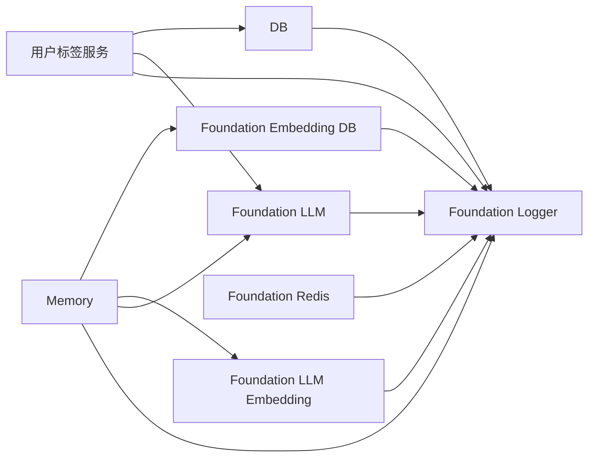

# Foundation 架构设计

**更新日期：** 2026-05-22
**状态：** 当前实现口径  
**范围：** Logger、DB、Redis、Embedding DB、LLM、LLM Embedding 六个独立基础组件。

## 1. 架构目标

Foundation 是可被 Memory、用户标签服务和后续功能复用的基础组件集合。它只封装外部基础设施或横切能力，不包含业务规则，也不感知 Agent、Workflow、Chat 或用户标签的业务模型。

当前 Foundation 组件：

| 组件 | 职责 | 是否业务耦合 |
|---|---|---|
| Logger | 结构化日志、OpenTelemetry active span trace/span 读取、脱敏 | 否 |
| DB | SQL 连接池、query、transaction、健康检查 | 否 |
| Redis | Redis KV / JSON / list / delete 等基础能力 | 否 |
| Embedding DB | 向量写入、检索、按用户删除；通过 provider 接口切换 Qdrant / Milvus / Pinecone / Chroma / pgvector / memory | 否 |
| LLM | OpenAI SDK Chat Completions 初始化、结构化输出、tool/function calling、streaming | 否 |
| LLM Embedding | OpenAI SDK Embeddings 初始化和向量生成；不负责向量存储 | 否 |

## 2. 初始化边界

所有组件均由组合根显式初始化。组件内部不得读取 YAML、不得直接读取散落环境变量、不得创建其他 foundation 组件。

```text
config/odd-agent.yaml
        │
        ▼
强类型 config loader
        │
        ├── Logger.init(loggerConfig)
        ├── DB.init(dbConfig, { logger, secretProvider })
        ├── Redis.init(redisConfig, { logger, secretProvider })
        ├── EmbeddingDB.init(embeddingDbConfig, { logger, provider: embeddingDbProvider })
        ├── LLM.init(llmConfig, { logger, secretProvider })
        └── LLMEmbedding.init(llmEmbeddingConfig, { logger, secretProvider })
```

除 Logger 外，所有组件初始化必须接收 `logger`。Secret 只通过 `secretProvider.getSecret(secretRef)` 取得，日志不得输出 API key、password、token、完整连接串等敏感内容。

## 3. 日志和 Trace

Logger 初始化时注册 OpenTelemetry `AsyncLocalStorageContextManager`。业务方法不传自定义 `LogContext`，Logger 从 `context.active()` 中读取当前 span 的 `trace_id` / `span_id`。

业务字段由调用方显式放入日志 fields，例如：

- `component`
- `bounded_context`
- `request_trace_id`
- `user_id_hash`
- `conversation_id`
- `memory_id`
- `duration_ms`

Logger 不理解业务上下文，不推断 userId / conversationId。

## 4. 组件调用关系



说明：

- Memory 使用 Embedding DB、EmbeddingDbProvider、LLM、Logger；Memory 会在自己的 init 中用 provider 初始化 Embedding DB，不再使用 Foundation DB 保存长期记忆。
- 用户标签服务使用 DB、LLM、Logger；Redis 和 Embedding DB 当前作为独立能力保留。
- Embedding DB 推荐由组合根或 Memory 初始化流程注入 Qdrant/Pinecone/Milvus/Chroma 这类独立向量库 provider，不再默认复用 PostgreSQL。

## 5. 当前约束

- 配置只允许来自 `config/odd-agent.yaml` 的强类型解析结果。
- LLM 不按调用级别临时切换 `baseUrl/model`；不同模型或不同 base URL 必须创建不同 LLM 对象。
- LLM Embedding 与 LLM Chat Completions 隔离；不同 embedding 模型、base URL 或维度必须创建不同 LLM Embedding 对象。
- Embedding DB 组件配置只保留 Foundation 通用约束；组件本体只保留公共校验、日志和生命周期管理，具体实现必须由初始化 deps 注入并实现统一 provider 接口。
- `EmbeddingDbConfig.collectionName` 必须映射到 provider 的真实存储分区：pgvector 表名、Qdrant/Chroma/Milvus collection 名、Pinecone namespace；Pinecone index 仍由 provider endpoint 指向。
- `pgvector` 保留为兼容 provider；`memory` 仅用于测试；`milvus` / `pinecone` / `chroma` 均提供独立 provider 类，endpoint、凭据、API version 等 provider 私有配置在各自构造参数中维护，不进入 `EmbeddingDbConfig`。
- DB、Redis、Embedding DB、LLM 都必须输出 started/succeeded/failed 日志。
- Foundation 组件不能引入多 Agent、Chat、Session、Workflow 等旧业务概念。

## 6. 相关文档

- `docs/development/foundation/功能文档.md`
- `docs/progress/foundation/功能现状.md`
- `docs/testing/foundation/embedding-db-真实场景回归_2026-05-20.md`
