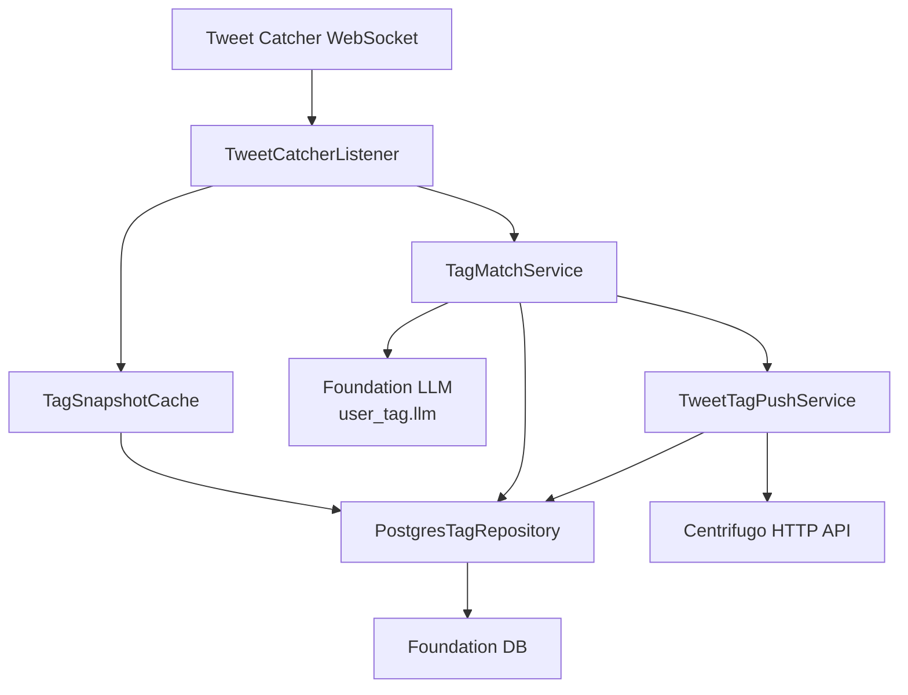

# 用户标签架构设计

**更新日期：** 2026-05-20  
**状态：** 当前实现口径  
**范围：** 用户标签、Tweet Catcher 推文监听、LLM 标签匹配、Centrifugo 推送。

## 1. 定位

用户标签是当前服务保留的业务功能。它不依赖多 Agent、Chat、Workflow，也不依赖 Memory。它通过 foundation 组件完成：

- PostgreSQL 标签与匹配结果存储。
- LLM 推文标签匹配。
- Logger 结构化日志。
- Centrifugo 推送。
- Tweet Catcher WebSocket 监听。

## 2. 运行时结构



## 3. 初始化

组合根负责初始化 foundation logger 和 DB，然后调用 user-tag runtime 初始化方法。

不同功能的 LLM 必须独立创建。用户标签使用 `user_tag.llm`，不能复用 Memory 或其他功能的 LLM 对象。

配置 section：

| section | 用途 |
|---|---|
| `logger` | 结构化日志配置，对应 Foundation Logger 组件 |
| `db` | 标签与匹配结果存储配置，对应 Foundation DB 组件 |
| `centrifugo` | 共享推送配置 |
| `tweet_catcher` | 共享 WebSocket 监听配置 |
| `user_tag` | 用户标签功能配置 |
| `user_tag.llm` | 用户标签专用 LLM 配置 |

## 4. 推文处理流程

```text
Tweet Catcher op=0 monitor event
  -> listener 生成 trace
  -> 读取 active tag snapshot
  -> TagMatchService 构造 LLM 输入
  -> LLM 输出命中的英文 tag name 数组
  -> 服务端按 name 映射回数据库 tag
  -> tweet_tag_matches 按 tweet_id + tag_id 存储
  -> Centrifugo 按 tag channel 分别推送
```

关键规则：

- 只处理真实推文事件，心跳、ready、auth control message 不进入业务匹配。
- LLM 只接收候选英文标签名数组和 `<media_input>...</media_input>` 包裹的推文文本。
- 数据库 tag_id、category、完整 lang_metadata 不传给 LLM。
- 一条推文命中多个 tag 时，数据库按 tag 维度写多条 match，并向多个 tag channel 推送。
- 通过 tweet_id 去重查询历史列表时，接口层按需求对返回推文去重。

## 5. 存储

主要表：

| 表 | 职责 |
|---|---|
| `tags` | 标签目录 |
| `user_tags` | 用户订阅标签 |
| `tweet_tag_matches` | 推文命中标签记录 |

`tweet_tag_matches` 是 tag 维度存储：同一条推文命中多个标签时会有多行，便于按标签频道推送和审计。

## 6. 对外/内部接口

| 接口 | 用途 |
|---|---|
| `GET /internal/tags` | 查询标签 |
| `POST /internal/user-tags` | 用户订阅标签 |
| `DELETE /internal/user-tags/:tagId` | 用户取消订阅 |
| `POST /internal/tag/match-text` | 推文文本标签匹配 |
| `GET /internal/user-tag/tweets` | 按 `x-user-id` 分页查询用户匹配历史推文，并按 tweet id 去重 |

用户身份只从可信上游 header `x-user-id` 读取，不从 query/body 读取。

## 7. 日志

关键日志：

- `tweet_catcher.connected`
- `tweet_catcher.ready`
- `tweet_catcher.tweet_received`
- `tag_match.started`
- `tag_match.llm_completed`
- `tag_match.completed`
- `tag_push.publish_started`
- `tag_push.publish_completed`
- `tag_push.publish_failed`

日志需要包含 trace、耗时、tag 数量、matched tag、channel、tweet id、错误信息。Secret 不得入日志。

## 8. 相关文档

- `docs/development/user-tag/功能文档.md`
- `docs/development/user-tag/接口设计.md`
- `docs/development/user-tag/表设计.md`
- `docs/progress/user-tag/功能现状.md`
- `docs/testing/user-tag/真实链路测试报告_2026-05-20.md`
