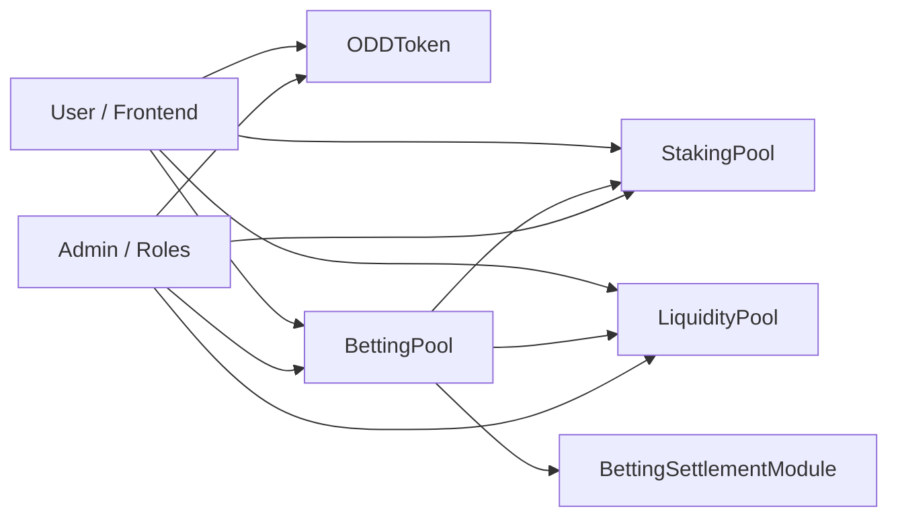
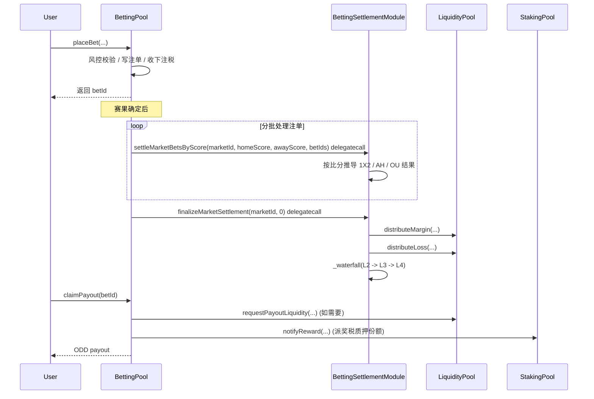
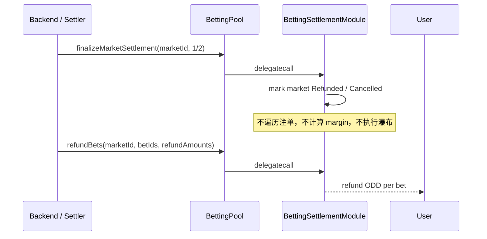
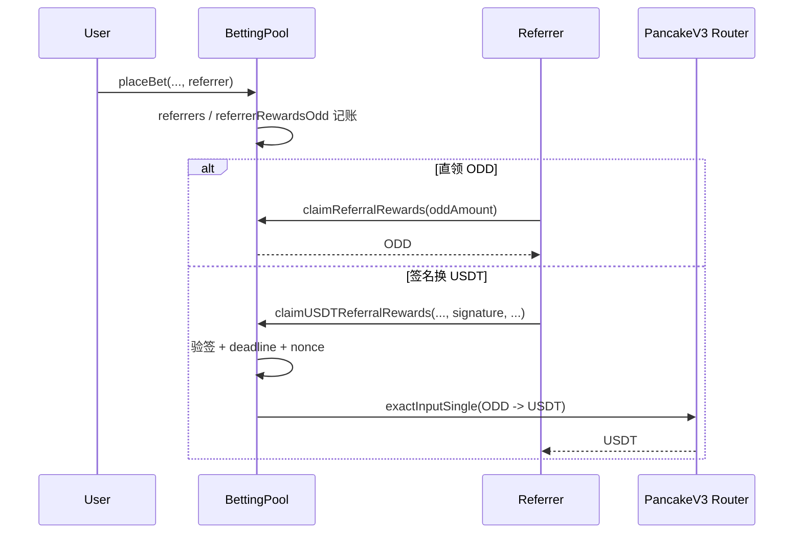
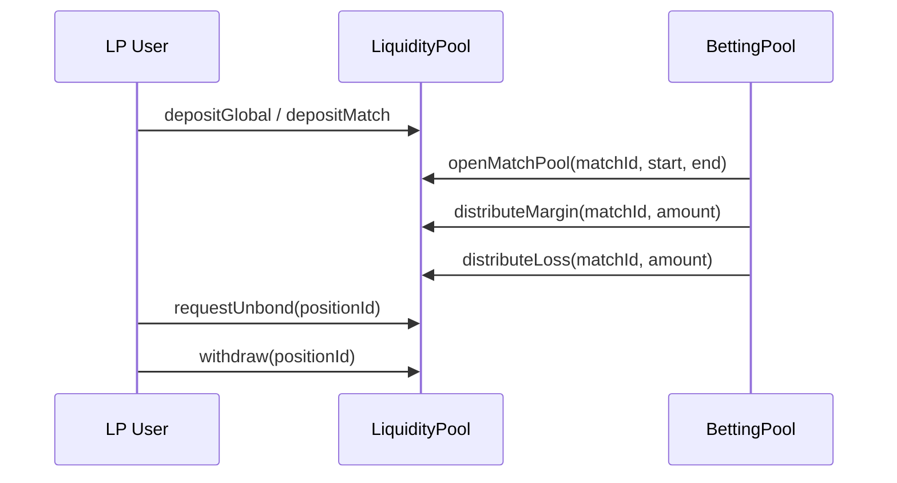

# 架构图与业务流程图

**状态：** AH 扩盘口流程已实现
**日期：** 2026-05-24
**基线：** `docs/research/2026-05-24-AH扩盘口最小改造调研.md` 与 `docs/development/2026-05-24-AH扩盘口比分结算实施方案.md`

说明：本文流程图已同步到当前 AH 扩盘口与 score-based 分批结算实现，旧结算 ABI 已删除。

## 1. 模块结构图

## 2. 下注与结算主流程

## 2.1 退款 / 取消终态流程

## 3. 推荐奖励流程

## 4. LP 主流程

