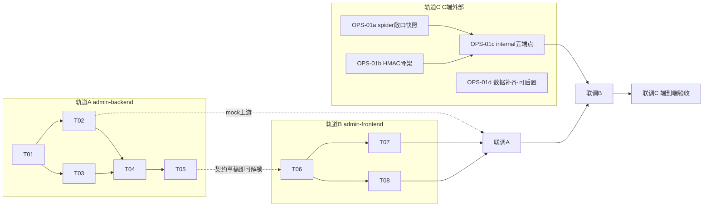

# DD002 信号灯 · 任务索引 / 统一执行方案 / 联调方案

> 方案：[`../DD.md`](../DD.md)（v2，D1-D7 已拍板）
> 角色启动文件（KICKOFF）：
> · 后端（本仓）`/Users/hang/work/oddfi-admin-backend/docs/dd002-risk-signal/handoff/KICKOFF-admin-backend.md`
> · 前端 `/Users/hang/work/oddfi-admin-backend/docs/dd002-risk-signal/handoff/KICKOFF-admin-frontend.md`
> · C 端 `/Users/hang/work/oddfi-admin-backend/docs/dd002-risk-signal/handoff/KICKOFF-webapi-ops.md`
> 分支：admin-backend `feat/risk-signal` ｜ admin-frontend `feat/risk-signal`
> 通用约束：中文注释（CLAUDE.md §1）、zerolog 结构化日志、table-driven 测试强制（testing.md）、commit 中文无 Co-Authored-By（git-workflow.md）、docs/api.md 同步（api-docs-required.md）

---

## 1. 任务总索引（三轨分拆）

### 轨道 A · 管理后台后端（本仓，5 个 task）

| 编号 | 标题 | 前置 | 状态 |
|---|---|---|---|
| [T01](./DD002-T01-errcode-dto.md) | errcode + 共享 DTO + upstream 路径常量 | — | ✅ `3929950` |
| [T02](./DD002-T02-events-proxy.md) | events proxy handler ×5 + mock 上游 + 单测 | T01 | ✅ `fa1dd09` |
| [T03](./DD002-T03-approval-counts.md) | approval/counts 聚合 + 降级语义 + 单测 | T01 | ✅ `fa1dd09` |
| [T04](./DD002-T04-router-rbac.md) | 路由注册 + RBAC + 限流 + rbac.md 矩阵 | T02, T03 | ✅ `797a8e9` |
| [T05](./DD002-T05-api-docs.md) | docs/api.md 契约同步 + 联调 curl 集 | T04 | ✅ `18eadf6` |

> 轨道 A 已完成阶段 4 team:2 review（双 APPROVE）+ 阶段 5 修复（`be35dc8`），报告见 [`../result/dev-report-admin-backend.md`](../result/dev-report-admin-backend.md)。

### 轨道 B · 管理后台前端（oddfi-admin-frontend，3 个 task）

| 编号 | 标题 | 前置 | 状态 |
|---|---|---|---|
| [T06](./DD002-T06-fe-foundation.md) | SignalTag（4 色语义 token）+ types + dataProvider/rbac 扩展 + 资源注册 | 契约定稿（T05 草稿即可；实际按 DD §3.3 先行） | ✅ `2245a45` |
| [T07](./DD002-T07-fe-risk-list.md) | 赛事风险列表页（KPI 联动 + 两级 Table + 全部原型交互） | T06 | ✅ `57e1430` |
| [T08](./DD002-T08-fe-modals-badge.md) | 调整历史弹窗 + 审批中心弹窗 + 铃铛 badge | T06（与 T07 可并行） | ✅ `8f6ac62`（+review 修复 `883ed1b`） |

### 轨道 C · C 端外部前置（oddfi-backend 仓，OPS 协作交付）

| 编号 | 标题 | 前置 | 阻塞谁 | 状态 |
|---|---|---|---|---|
| [OPS-01a](../handoff/DD002-OPS-01a-exposure-snapshot.md) | spider 落 `market_exposure_snapshot`（每方向 stake） | — | OPS-01c 的判级链路 | ⬜ |
| [OPS-01b](../handoff/DD002-OPS-01b-internal-hmac.md) | 核实/合并 web-api internal HMAC 骨架（service_auth） | — | OPS-01c | ⬜ |
| [OPS-01c](../handoff/DD002-OPS-01c-internal-endpoints.md) | web-api `/internal/admin/events/*` 五端点 + admin_risk_decisions 表 + 阈值配置 | OPS-01a, 01b | 联调 B | ⬜ |
| [OPS-01d](../handoff/DD002-OPS-01d-data-backfill.md) | lp_pool / score / settle 时间 / settle_pl 数据源补齐（**可后置，不阻塞上线**） | — | D6 null 组字段点亮 | ⬜ |

---

## 2. 依赖图

**关键解耦点**：T02 自带 mock 上游（`cmd/mock-webapi`），轨道 A/B 全程**不被轨道 C 阻塞**；只有联调 B 起需要 OPS-01c 真上游。

---

## 3. 统一执行方案（波次）

| 波次 | 内容 | 并行性 | 出口标准（commit 点） |
|---|---|---|---|
| **W0** | OPS-01a/01b 发给 C 端侧启动（交接文档=对应 OPS task 文件）；本仓开分支 | 三轨同时起跑 | OPS 契约已送达确认 |
| **W1** | T01（errcode/DTO/常量） | 单任务 | `vet+test` 绿，commit①「T01」 |
| **W2** | T02 ∥ T03（proxy ×5 + mock 上游 ∥ counts 聚合） | 后端双任务并行 | 全部单测绿，commit②「T02/T03」 |
| **W3** | T04 ∥ T06（路由 RBAC ∥ 前端地基） | 跨仓并行 | 后端 build 绿 + 前端 `tsc/lint` 绿，commit③（两仓各一） |
| **W4** | T05 ∥ T07 ∥ T08（文档 ∥ 列表页 ∥ 弹窗 badge） | 三任务并行 | docs hook 过 + 前端两页可跑，commit④ |
| **W5** | **联调 A**（前端 ↔ admin-backend，mock 上游） | — | 联调 A checklist 全过，修复 commit⑤ |
| **W6** | **联调 B**（admin-backend ↔ web-api internal，等 OPS-01c） | 等外部 | 契约 diff 清零 |
| **W7** | **联调 C** 端到端验收 + 阶段 4 team:2 review → 阶段 5 修复 → 阶段 6 归档 | review 双 agent 并行 | 全绿 + 验收表签收 |

- 每波次结束 = 单 commit（中文 message 列 task 编号），squash merge 进 main。
- W6 若 OPS-01c 延期：W5 完成后即可先行 review（mock 上游覆盖全部契约形态），W6/W7 顺延为补充回归，不空等。

---

## 4. 联调方案（三段递进）

### 联调 A · 前端 ↔ admin-backend（不依赖 C 端，mock 上游）

**环境**：本机 `go run ./cmd/mock-webapi`（:9090，T02 交付）→ `go run cmd/server/main.go`（:8081，config 指 mock）→ 前端 `npm run dev`（:5173）。

mock 夹具固定 8 个事件，覆盖全形态：四灯色 × 未开盘 × 已结算（含比分/盈亏）× 红灯已决策 × 红灯重升重入队。

**checklist**：
- [ ] 信封拆包 `{code:0,data:{list,total,page,page_size}}`；ID 均为字符串（`,string`）
- [ ] 分页 `page/page_size`；多值筛选 `?signal=red,orange` 逗号单 key 透传
- [ ] 四角色 RBAC 实测：finance 可读不可决策（403 INSUFFICIENT_ROLE）、customer_service 同；operator/super_admin 可决策
- [ ] risk-decision：缺 X-Idempotency-Key 拒绝；重复提交 RISK_DECISION_CONFLICT；非红灯 EVENT_NOT_RED_SIGNAL
- [ ] 决策乐观更新：退队、badge−1、行内降级 orange +「已人工处理」
- [ ] counts 上游挂掉（停 mock）：badge 保持上次值不弹错
- [ ] null 组字段（lp_pool/yield/score/settle_pl/times.settle）全部显示「—」；未开盘行各卡置灰
- [ ] KPI 点击联动（红/橙筛选、绿黄落 all）、橙 Tab 含红、settled 卡替换、时间 chip hover 高亮

### 联调 B · admin-backend ↔ web-api internal（OPS-01c 交付后）

**环境**：dev 服务器，HMAC secret 两侧 yaml 对齐（`webapi.service_token`），时钟偏差 < 签名容差。

- [ ] T05 的 curl 契约集逐条打真上游，响应与 mock 夹具做 **schema diff**（字段名/类型/null 性逐一核对，重点 `,string`、`signal` 字符串枚举、`max_exposure` 双义）
- [ ] HMAC 验签：篡改 body / 过期 ts / 错 key 均 401
- [ ] 决策状态机闭环（真库）：决策落库 → pending_decision=false → 手工抬高敞口触发红灯重升 → 重新入队
- [ ] `signal=red` 查询绕缓存生效（连续两次请求观察新鲜度）
- [ ] 性能基线：risk/list 50 事件 p95 < 500ms（含上游往返）

### 联调 C · 端到端验收（dev 部署）

按既有部署流（交叉编译 → scp → systemctl restart，dev-token 签发实测——见项目记忆 deploy-admin-backend-flow）：

- [ ] Lark SSO 真登录 → 四角色账号各过一遍菜单可见性 + 操作权限
- [ ] 红灯端到端时效实测 ≤ 90s（合约触发 → spider → 聚合 → badge）
- [ ] 审批闭环演练：红灯出现 → 铃铛红点 → 弹窗决策（强制 remark）→ 消红点 → audit 留痕（decided_by=JWT 身份）
- [ ] 验收签收表交 PM（含 D6 null 组字段「待 OPS-01d 点亮」说明，预期管理）

---

## 5. 人工事项汇总

| 事项 | 谁 | 何时 |
|---|---|---|
| OPS-01a/b/c 排期确认 | C 端侧 | W0 |
| dev 环境 HMAC secret 配置（两侧 yaml） | 运维/hang | 联调 B 前 |
| D4 口径与 PM 留痕（队列只收 red） | hang → PM | 上线前任意时点 |
| OPS-01d 排期（解锁 lp_pool/yield/score/settle_pl） | C 端侧 | 可后置 |

## 6. 状态表（随波次更新）

| T01 | T02 | T03 | T04 | T05 | T06 | T07 | T08 | OPS-01a | 01b | 01c | 01d |
|---|---|---|---|---|---|---|---|---|---|---|---|
| ✅ | ✅ | ✅ | ✅ | ✅ | ✅ | ✅ | ✅ | ⬜ | ⬜ | ⬜ | ⬜ |

> 前端轨道 B 完工（2026-06-05，含双代理 review + 修复）：交付报告见 [`../result/RESULT-frontend.md`](../result/RESULT-frontend.md)，review 归档 [`../reviews/review-03-fe-code.md`](../reviews/review-03-fe-code.md) / [`review-04-fe-security.md`](../reviews/review-04-fe-security.md)。联调 A 等 T02 mock-webapi。
