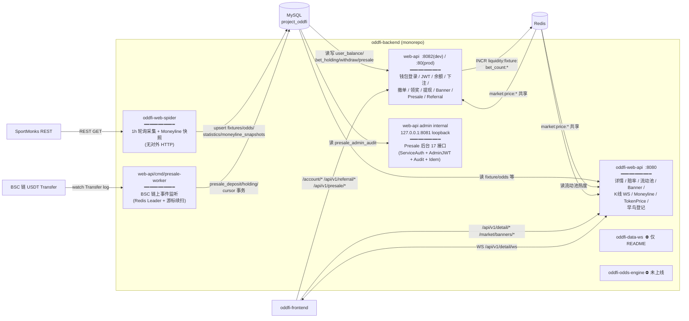

# oddfi-backend 跨服务架构

> 最后更新：2026-05-27
> 范围：本仓库（monorepo）内所有 Go 服务之间的关系。单服务深度文档（启动、表结构、ADR、事故复盘）仍在各自 `*/docs/`。

## 1. 一张图看懂



## 2. 服务间没有 RPC——交互全部走 MySQL + Redis

整个 monorepo **没有一个出站 HTTP client** 调另一个 Go 服务（已 grep 全代码与 `go.mod` 确认）。跨服务交互全部以 **共享存储** 实现：

| 通道 | 生产者 → 消费者 | 载体 | 备注 |
|---|---|---|---|
| 赔率/赛事数据 | spider → oddfi-web-api / web-api | MySQL：`oddfi(_dev)_fixtures` / `_odds` / `_statistics` / `_fixture_results` | upsert 写，读侧 GORM 查 |
| 下注风控 | web-api 下注事务读 spider 写的数据 | MySQL：`oddfi_(dev_)odds.value / handicap / total / stopped` | 必须开启相同 env，否则 `dev` 表名错配 |
| 流动池热度排序 | web-api → oddfi-web-api | Redis：`liquidity:fixture:bet_count:{fixture_id}` | INCR 不过期，是派生数据，写失败仅记日志不回滚资金 |
| Token Price | 外部喂价 → 两边都读 | Redis：`market:price:{chain}:{symbol}` | 两个服务的 `/market/price` 与 `/token/price` 都从这里读 |
| Moneyline 历史曲线 | spider → oddfi-web-api | MySQL：`oddfi_moneyline_snapshots` / `_collection_status` | 详见 [`oddfi-web-spider/docs/MONEYLINE_TABLE_DEPLOY.md`](../oddfi-web-spider/docs/MONEYLINE_TABLE_DEPLOY.md) |
| 链上认购入账 | BSC → presale-worker → 内部 MySQL | MySQL：`presale_deposit` / `presale_holding` / `presale_event_cursor` | worker 是 web-api 仓库下的独立进程，与 HTTP server 同机部署 |
| 邀请绑定 | 任意业务（含 presale） → user_referral_bind | MySQL：`user_referral_code` / `user_referral_bind` | 站点级基础设施，不依赖 presale，见 [`web-api/docs/dd-invest/batches/B1-referral.md`](../web-api/docs/dd-invest/batches/B1-referral.md) |

**含义**：改 MySQL 表结构、改 Redis key、改 `dev` 表名后缀策略，都属于"跨服务变更"，必须同时对齐所有写入/读取方。

## 3. 数据流分场景拆解

### 3.1 用户打开赛事详情

```
SportMonks ─1h─▶ spider ─upsert─▶ MySQL ◀─SELECT─ oddfi-web-api ─JSON─▶ 前端
                                            ▲
                          Redis(market:price + liquidity:bet_count)
```

oddfi-web-api 不写库；spider 不对外提供 HTTP。

### 3.2 用户下注 / 撤单 / 领奖

```
前端 ─POST /account/bet_place─▶ web-api
                                    │
                                    ├─tx─▶ MySQL: 读 OddDB 快照校验，写 user_bet_holding / asset_ledger，扣 balance
                                    └────▶ Redis: INCR liquidity:fixture:bet_count:{fixture_id}  (失败仅日志)
```

撤单 / 领奖路径同上，不同表与 ledger type，详见 [`web-api/AGENTS.md`](../web-api/AGENTS.md) 第 4 节业务流程。

### 3.3 预售链上入账（DD-INVEST B2）

```
BSC USDT Transfer ─watch─▶ presale-worker (Leader)
                                    │
                                    ├─tx─▶ MySQL: presale_deposit (uk_tx_hash+log_index 幂等)
                                    ├──── ─▶  presale_holding (UPSERT 加权平均成本)
                                    ├──── ─▶  presale_round.sold_odd (乐观锁 +delta ≤ supply)
                                    └─async ─▶ Lark Webhook (异常事件)
```

worker 启动时用 Redis `SET NX EX` 抢 leader，TTL/3 续约；非 leader 空转。

### 3.4 Presale 运营操作

两条等价路径，都落 `presale_admin_audit`：

- **HTTP**：admin-backend → `127.0.0.1:8081/internal/admin/presale/*`（ServiceAuth HMAC + Admin JWT + Idempotency）
- **SSH 预案脚本**：`web-api/scripts/presale-ops/*.go`（`//go:build ignore`，`go run` 默认 dry-run，`--note ≥10 字符`）

详见 [`web-api/scripts/presale-ops/README.md`](../web-api/scripts/presale-ops/README.md)。

## 4. 进程拓扑速查

| 进程 | 部署位置 | 端口 | 启动入口 |
|---|---|---|---|
| oddfi-web-api | dev-market-api / market-api EC2 | 8080 | `oddfi-web-api/main.go` |
| web-api 公网 | 后端 EC2 | 8082(dev) / 80(prod) | `web-api/cmd/server/main.go` |
| web-api admin internal | 同上进程内 | 127.0.0.1:8081 (loopback) | 同上 main.go 第二个 ListenAndServe |
| presale-worker | 与 web-api 同机不同进程 | 无 | `web-api/cmd/presale-worker/main.go` |
| oddfi-web-spider | 独立 EC2 / Docker `--network host` | 无 | `oddfi-web-spider/main.go` |
| oddfi-data-ws | — | — | 仓库内仅 README，**未实现** |
| oddfi-odds-engine | — | — | `cmd/engine/main.go` 还有硬编码 DSN，**未上线** |

部署细节见 [`.omc/wiki/INFRA-backend-deploy.md`](../.omc/wiki/INFRA-backend-deploy.md) 与 [`.omc/wiki/infra-oddfi-web-api-dev-market-api-market-api.md`](../.omc/wiki/infra-oddfi-web-api-dev-market-api-market-api.md)。

## 5. 共享存储映射

### 5.1 MySQL `project_oddfi`

按"主要写入方"分组（任意服务都可读）：

| 写入方 | 表 |
|---|---|
| oddfi-web-spider | `oddfi(_dev)_fixtures` / `_odds` / `_statistics` / `_fixture_results` / `_leagues` / `oddfi_moneyline_snapshots` / `_collection_status` |
| web-api（HTTP） | `user(_dev)` / `user_balance(_dev)` / `asset_ledger(_dev)` / `user_bet_holding(_dev)` / `banner_bet_order(_dev)` / `withdraw_record` / `deposit_address` / `user_deposit_address` / `deposit_record` / `early_access` / `user_referral_code` / `user_referral_bind` |
| presale-worker | `presale_round` / `presale_deposit` / `presale_holding` / `presale_event_cursor` / `presale_ops_event` / `presale_config` |
| admin-backend (外部仓库) | `presale_admin_audit`（web-api admin internal 读它写审计） |

**`env=dev` 表名后缀规则**只在 web-api 实现，spider 在两侧都用 `tables.*` 配置直配；mock SQL 脚本写 `oddfi_odds`，但 web-api dev 读 `oddfi_dev_odds`，需要手动对齐。

### 5.2 Redis（单实例共用 DB 0）

| key 形态 | 写入方 | 读取方 | TTL |
|---|---|---|---|
| `wallet_session:{session_id}` | web-api 钱包登录 step 1 | web-api 钱包登录 step 2 | 5min（代码实际 ~250s，见 web-api ARCHITECTURE.md §8） |
| `refresh_token:{user_id}` | web-api 登录成功 | web-api refresh 接口 | refresh_expiry |
| `token_blacklist:{jti}` | web-api Logout | web-api AuthMiddleware | access_expiry |
| `admin:user:{user}` | 人工运维种入 | web-api `/admin/order/*` | 无 |
| `market:price:{chain}:{symbol}` | 外部喂价进程 | web-api `/market/price` + oddfi-web-api `/token/price` | 喂价方决定 |
| `deposit_addresses_{chain}` | web-api 新用户创建 | 充值监听（外部） | 无 |
| `liquidity:fixture:bet_count:{fixture_id}` | web-api 下注成功 | oddfi-web-api 流动池排序 | 无 |
| `presale:leader:{key}` | presale-worker 抢锁 | 自身续约 | `RedisLeaderTTLSec` |

## 6. 外部依赖

| 依赖 | 协议 | 谁在用 | 凭据位置 |
|---|---|---|---|
| SportMonks REST | HTTPS GET | spider 主路径 + oddfi-web-api（保留 client 但实际用 DB 数据） | yaml `sportmonks.api_token` |
| BSC Alchemy RPC | HTTPS / WSS | presale-worker | yaml `presale.bsc_rpc_url`（用户付费节点，见项目记忆） |
| Lark Webhook | HTTPS POST | web-api 异常告警 + 预案脚本 + spider 容器监控 | yaml `presale.lark_webhook_url` + `LARK_WEBHOOK_URL` env |
| Sentry | HTTP | 前端在用，后端目前未接入 | — |

## 7. 后续要补的关系（路标）

- `oddfi-data-ws` 真要做，定位需先与 oddfi-web-api 的 `/api/v1/detail/ws` 对齐：要么独立成新服务，要么把现有 K 线 WSHub 抽出来；当前仓库占位会让新人误判。
- `oddfi-odds-engine` 设计是"接 web-api 下注事件 → 自营盘动态赔率"，但当前 web-api 下注流程不发任何外部信号；要上线必须新增 channel/MQ 或事件总线。
- 服务间 RPC 化的诉求一旦出现（例如下注前查 oddfi-web-api 的最新赔率而非直接查 DB），就需要重新评估这张图。

## 8. 关联文档

- 各服务 README / ARCHITECTURE：[`oddfi-web-spider/docs/ARCHITECTURE.md`](../oddfi-web-spider/docs/ARCHITECTURE.md)、[`web-api/ARCHITECTURE.md`](../web-api/ARCHITECTURE.md)、[`oddfi-odds-engine/README.md`](../oddfi-odds-engine/README.md)
- 服务一句话定位与 owner：[`SERVICES.md`](./SERVICES.md)
- 接口分布与 Swagger 链接：[`API.md`](./API.md)
- 跨仓库（前端 + 合约）视角：[`.omc/wiki/INFRA-repos.md`](../.omc/wiki/INFRA-repos.md)
- 部署：[`.omc/wiki/INFRA-backend-deploy.md`](../.omc/wiki/INFRA-backend-deploy.md)
