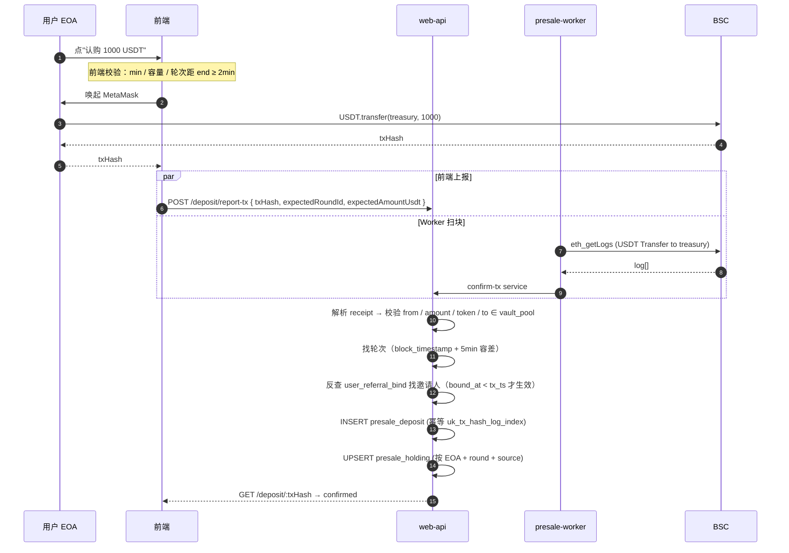
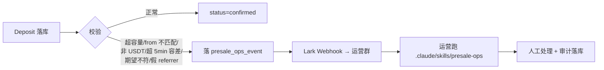

# 00 · 总体架构 / 决策 / 风险（V3 · 模型 B 改造版）

> 本文档对应 2026-05-25 grill-me 8 支决策清单（PRD V2 + 决策对账：见 README §1）。
> V2 → V3 主要变化：订单驱动 → 事件驱动（Deposit-first）、邀请系统站点级、admin 接口搬 admin-backend、vesting/claim 整段砍掉、价格源砍掉（独立服务）。

## 1 总体定位

**纯链下记账方案**：本期不部署 / 不修改任何合约。金库地址 = 平台托管 EOA（multisig 冷钱包），只接收 USDT，不承担任何业务逻辑。后端为业务真值：轮次配置 / 入账记录 / 持仓聚合 / 邀请关系，全部存在后端 DB。链上只是「资金动作发生过」的证据。

**Deposit-first 事件驱动模型**：

- 后端**不创建订单**；用户点"认购"直接弹钱包发 USDT Transfer
- 链上 to=金库 的 USDT Transfer 即真相，前端 report-tx + Worker 监听双轨上报到后端
- 后端按 EOA / from / to / amount / block_timestamp 落 `presale_deposit` 表，按到账时所属轮次入账
- 无 `pending / expired / mismatch` 中间态；无金额严格匹配

**用户体验**：MetaMask 发普通 `USDT.transfer(treasury, amount)`，签 1 次，自付 BNB gas；不需要 approve、不调任何合约。

**不做 KYC**：本期不接入任何链下 KYC 流程。

**账户模型**：EOA 为资产 anchor，登录沿用现有 `/account/login_by_wallet`。本期不派生 SA、不实现 vesting / claim。

## 2 服务拆分（双服务架构）

```
┌─────────────────────────────────────────────┐
│ oddfi-backend (web-api 服务) — 用户域       │
│ 域名：api.oddfi.io / dev-api.oddfi.io       │
│ 进程：                                       │
│   1. web-api HTTP server                    │
│      ├─ /api/v1/presale/*  公开 / JWT       │
│      └─ /api/v1/referral/* 站点级 JWT       │
│   2. presale-worker (独立 binary)           │
│      ├─ USDT Transfer 监听（多金库地址池） │
│      ├─ Round status cron（5min/次）        │
│      └─ Lark webhook sender                 │
└─────────────────────────────────────────────┘
                ↓ 共享 MySQL ↓
┌─────────────────────────────────────────────┐
│ oddfi-admin-backend — 运营域                 │
│ 域名：admin.oddfi.io                         │
│ 现有：Lark OAuth + JWT + 4 角色 RBAC + 限流│
│ 新增：/admin/presale/*                       │
│      ├─ 轮次管理（pause/resume/reopen/...）  │
│      ├─ 配置管理（金库 / TGE）              │
│      ├─ 入账记录查询 / 迁移轮次             │
│      ├─ 异常事件处理                         │
│      └─ 操作审计                             │
└─────────────────────────────────────────────┘
```

**数据库共享**：admin-backend 直接 GORM 操作 `presale_*` 表，不走 web-api HTTP 接口（沿用 admin-backend 现有"避免循环依赖"原则）。

**运营预案脚本**：`web-api/scripts/presale-ops/*.go` + Claude Code skill `.claude/skills/presale-ops/`，处理无主转账确认 / 超额到账 / 跨轮次兜底等非常规事件。

## 3 后端职责

**web-api**：
- `/api/v1/presale/config`：返回轮次配置 + 金库地址 + 全局参数（公开）
- `/api/v1/presale/deposit/report-tx`：前端钱包发完 USDT Transfer 后上报 txHash（富信息版，带 expectedRoundId / expectedAmountUsdt 做 anomaly 检测）
- `/api/v1/presale/deposit/list` + `/:txHash`：用户查自己的入账历史
- `/api/v1/presale/position`：聚合返 ODD 持仓 + 累计投入 + 加权成本价（**不返**今日单价 / 今日价值，由独立平台币汇率服务提供）
- `/api/v1/referral/*`：站点级邀请系统（后续可被其他业务调用）

**presale-worker**：
- BSC USDT Transfer 监听（`eth_getLogs` 轮询 + 多金库地址池）
- 双轨会师：监听器扫到的 tx 与前端 report-tx 走同一 confirm-tx service，幂等键 `uk_(tx_hash, log_index)`
- Round status cron：每 5min 推进 `upcoming → active → ended`（受 `manual_override` 控制）
- Anomaly Lark webhook：异常事件推 Lark 群

**admin-backend**：
- 轮次运营操作（pause / resume / reopen / close / 改字段）
- 全局配置（金库地址 / TGE / referral_reward_pct）
- 入账记录查询 + 跨轮次迁移
- 异常事件人工处理 + 审计

## 4 复用现有底座

- web-api：Gin handler / service / repo 三层，GORM + MySQL（`DECIMAL(38,18)` 字符串），Redis（监听器 leader），`internal/pkg/snowflake`，`shopspring/decimal`
- admin-backend：现有 Lark OAuth + JWT + RBAC + 限流中间件 + audit middleware（待扫描确认；若无则新增 `presale_admin_audit` 表）
- 共享 MySQL 实例，admin-backend 现有架构已经直接 JOIN web-api 业务表

## 5 关键链路图

### 5.1 入金（Deposit-first 双轨）



### 5.2 异常处理



## 6 与原 V2 DD 的核心差异

| 维度 | V2（订单驱动） | V3（事件驱动） |
|---|---|---|
| 入账模型 | 订单 pending → 链上匹配 → confirmed | 链上 USDT Transfer 即真相，落 `presale_deposit` |
| 订单表 | `presale_order` 含状态机 5 态 | **砍**，改为 `presale_deposit`（无 pending/expired/mismatch） |
| 金额校验 | 严格等于 `pay_amount`，偏差进 mismatch | 实际到账即认（min 仅前端 + 创建意图时校验） |
| 超时处理 | 30 分钟自动 expired | 不主动 expire，用户任何时刻付款都认（前端 2min 边界禁下单） |
| 邀请系统 | `/api/v1/presale/referral/*` 业务耦合 | `/api/v1/referral/*` 站点级，后续可被其他业务调用 |
| Vesting + Claim | 完整 cron + Worker + EIP-191 签名 + 热钱包 | **整段砍**，schema 保留字段，合约就绪后再实现 |
| 价格源（今日价值） | 后端 Alchemy RPC 拉链上价 + Redis 缓存 | **砍**，由独立平台币汇率服务提供，前端调用 |
| 金库地址 | env 单地址 | env 默认值 + `presale_deposit.vault_address` 快照 + Worker 监听**多地址池** |
| Admin 接口 | 与 web-api 同进程 `/admin/*`（零鉴权） | 搬到 admin-backend，复用 Lark OAuth + RBAC |
| 错误码 | `EXPIRE / MISMATCH / AMOUNT_EXCEED_*` | `ANOMALY_*`（异常事件统一进 ops_event） |

## 7 关键风险与缓解

### 7.1 ✅ 已决事项

- **入金模型**：Deposit-first 事件驱动；前端 2min 禁下单 + 后端 5min 边界容差
- **邀请绑定**：一旦绑定不可撤销 / 不可改；绑定时间戳之前的转账无邀请奖励
- **邀请奖励**：只返 ODD 数量，USD 价值由前端调独立平台币汇率服务自算
- **Vesting / Claim**：本期完全不做；持仓总数字段保留，中间状态字段不实现
- **价格源**：预售后端不管 ODD 价格
- **TGE 改期**：与 round 时间窗解耦，运营各改各的；vesting anchor=TGE（schema 语义保留）
- **轮次切换**：售罄进 ended；下一轮按 start_ts 严格转 active；接受空窗期
- **轮次回退**：`manual_override` + `paused` 状态机，运营 pause/resume/reopen/close
- **从地址校验**：F1 严格匹配（智能合约钱包代付走预案）

### 7.2 ⚠️ 固有风险（模型 B 下新增）

| 风险 | 缓解 | 兜底 |
|---|---|---|
| **轮次边界用户被切价**：用户付款过程跨越轮次切换 | 前端禁下单前 2min + 后端 5min 容差 | 用户投诉走预案脚本改 round_id |
| **无主转账**：用户绕前端直转金库 | from EOA 不在 user_referral_bind / 任何活跃用户 → 进 anomaly | Lark 推送运营 → 客服联系用户 → 预案脚本转单 |
| **超额到账**：到账金额 > 本轮剩余容量 | A4：部分按本轮算 + 超出进 anomaly | 预案脚本人工分配（按本轮 / 滚下一轮 / 退款） |
| **重组导致到账回滚** | 等 ≥ 3 区块确认（BSC ~9s） | 索引器记录 block_number，可手动按高度重放 |
| **监听器漏块** | 游标 `presale_event_cursor` 单事务提交；多金库地址池监听 | 手动从历史高度 replay |
| **Worker 多实例重复扫块** | Redis `SET NX EX 30s` 抢 leader | 失败自动放弃下一轮抢锁 |
| **金库切换窗口** | env 改地址 + 监听器配置多地址池（新+旧并存） | 老订单到账老地址仍能正确入账（vault_address 快照） |
| **TGE 营销基准价被市价干扰** | `tge_open_price_usd` 是 PRD 设定值，不依赖价格服务 | 运营改 |

### 7.3 与合约的边界（关键）

**本期完全不部署 / 不修改任何合约**。

| 对象 | 是合约？ | 谁部署 | 我们做什么 |
|---|---|---|---|
| USDT (BEP20) | 标准 ERC20，已存在 | Tether | 监听 `Transfer(to ∈ vault_pool)` 事件 |
| ODD (BEP20) | 标准 ERC20，项目方已部署 | 项目方 | **本期不发币**（claim 整段砍），仅记账 ODD 数量 |
| Treasury 钱包 | 不是合约，**multisig 冷钱包** | 项目方 | 只接 USDT，不签任何业务 tx |

所有"链上动作"都只是标准 ERC20 transfer（用户单方发起），后端无需私钥 / mint 权限 / owner 权限。

## 8 与现有代码的集成点

### 8.1 web-api（用户域）

| 现有点 | 改动 |
|---|---|
| `internal/router/*.go` | 新建 `RegisterPresaleRoutes`、`RegisterReferralRoutes`，挂 `/api/v1/presale`、`/api/v1/referral` |
| `internal/handler/` | 新增 `presale.go`、`referral.go` |
| `internal/service/` | 新增 `presale.go`、`presale_deposit.go`、`referral.go` |
| `internal/repository/` | 新增 `presale_round.go`、`presale_deposit.go`、`presale_config.go`、`presale_holding.go`、`presale_ops_event.go`、`user_referral_bind.go`、`user_referral_code.go`、`presale_event_cursor.go` |
| `internal/model/` | 上述 8 张表 model + 各接口 request/response DTO |
| `internal/chain/` | 新增 `presale_listener.go`（USDT Transfer 监听，支持多金库地址池） |
| `cmd/presale-worker/main.go` | **新增独立 binary**：监听器 + cron + Lark webhook sender |
| `internal/config/` | 新增 `PresaleConfig`：treasury / vaultPool / usdtAddr / minSubscribeUsd / rpcUrl / confirmBlocks / boundaryToleranceMin / pollInterval / larkWebhookUrl |
| `internal/middleware/auth.go` | 复用现有 JWT 中间件；登录成功 hook 注入"生成邀请码"逻辑（INSERT IGNORE 到 `user_referral_code`，CSPRNG 随机 + 5 次重试） |

### 8.2 admin-backend（运营域）

| 改动 | 文件 |
|---|---|
| 新建路由组 `/admin/presale/*` | `internal/router/router.go` 注册 |
| 新增 handler / service / repository | `internal/handler/presale_*.go` / `internal/service/presale_*.go` / `internal/repository/presale_*.go` |
| RBAC 矩阵更新 | `.claude/rules/rbac.md` 补预售路径权限映射 |
| 新建 audit 表 + middleware | `internal/middleware/presale_audit.go`（所有 mutate 接口前后落 `presale_admin_audit`） |
| 新建 migration | `migrations/0002_create_presale_admin_audit.sql` |

### 8.3 共享 schema migration

预售业务表的 migration 放 **web-api** 仓库（与业务代码同源）：`migrations/00xx_create_presale_*.sql`。admin-backend 通过 GORM 模型在启动时不自动建表，仅引用现有 schema。

## 9 不做的事（明确范围）

- ❌ 不部署 / 不修改任何合约
- ❌ 不做 KYC
- ❌ 不做 vesting cron / claim / EIP-191 签名 / 热钱包 / ODD 链上发放（schema 字段保留）
- ❌ 不做 ODD 价格抓取 / Alchemy 集成 / LP 池子查询（独立服务负责）
- ❌ 不做 SA 派生
- ❌ 不做用户自定义邀请码（CSPRNG 自动生成不可改）
- ❌ 不做 EOA 私钥迁移
- ❌ 不做 web-api `/admin/*` 零鉴权治理（SEC-001 单独立项）
- ❌ 不做退款链上操作（退款走预案 + 链下转账，本期不实现自动退款）
