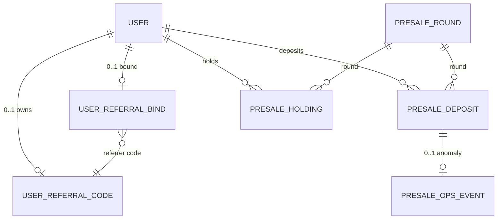

# 01 · 数据模型（V3 · 模型 B 改造版）

> 命名沿用 `snake_case`，金额一律 `DECIMAL(38,18)` 字符串入库，时间统一 `BIGINT` 毫秒。
> Soft delete 不引入；状态机不删行。
> 所有表使用 `utf8mb4` `InnoDB`。

## 1 ER 关系图



## 2 表清单

| # | 表 | 用途 | 量级 | 归属服务 |
|---|---|---|---|---|
| 1 | `presale_round` | 轮次配置（6 行初始） | 6 行 | web-api 业务 |
| 2 | `presale_deposit` | 链上入账记录（替代原 presale_order） | 10w~50w | web-api 业务 |
| 3 | `presale_config` | 单行全局配置（金库 / TGE / 基准价 / 容差） | 1 行 | web-api 业务 |
| 4 | `presale_holding` | 持仓聚合（按 EOA + round + source） | 10w | web-api 业务 |
| 5 | `presale_event_cursor` | 监听器游标 | 1 行 / 金库地址 | web-api 业务 |
| 6 | `presale_ops_event` | 异常事件待处理 | < 1w | web-api 业务 |
| 7 | `user_referral_code` | 邀请码（站点级） | 与用户量同级 | web-api 业务 |
| 8 | `user_referral_bind` | 邀请绑定关系（站点级） | 与用户量同级 | web-api 业务 |
| 9 | `presale_admin_audit` | 运营操作审计 | < 10w | admin-backend |

**砍掉的表**（V2 → V3）：

- `presale_order`（被 `presale_deposit` 替代）
- `presale_claim` / `presale_claim_tx`（vesting/claim 整段砍）
- `presale_referral_bind`（重命名 + 解耦为 `user_referral_bind`）

## 3 表结构

### 3.1 `presale_round`

```sql
CREATE TABLE `presale_round` (
  `id`                    VARCHAR(32)      NOT NULL COMMENT '轮次 ID, e.g. seed/strategic/ecosystem/public_a/public_b/public_c',
  `name`                  VARCHAR(64)      NOT NULL COMMENT '展示名, e.g. 种子轮',
  `round_type`            VARCHAR(16)      NOT NULL DEFAULT 'public' COMMENT 'private/public, 私募/公募',
  `price_usd`             DECIMAL(38,18)   NOT NULL COMMENT '单价 USD',
  `supply_odd`            DECIMAL(38,18)   NOT NULL COMMENT '本轮 ODD 总额度',
  `sold_odd`              DECIMAL(38,18)   NOT NULL DEFAULT 0 COMMENT '已售 ODD',
  `raised_usd`            DECIMAL(38,18)   NOT NULL DEFAULT 0 COMMENT '已募 USD',
  `target_raise_usd`      DECIMAL(38,18)   NOT NULL COMMENT '目标募集 USD (≈ supply × price)',
  `min_per_order_usd`     DECIMAL(20,6)    NULL     COMMENT '单笔下限 (NULL=无限制, 本期初始不配)',
  `max_per_wallet_usd`    DECIMAL(20,6)    NULL     COMMENT '单钱包累计上限 (NULL=无限制, 本期初始不配)',
  `tge_release_pct`       DECIMAL(5,2)     NOT NULL COMMENT 'TGE 即时释放比例 % (0~100), schema 落定本期不计算',
  `linear_release_days`   INT UNSIGNED     NOT NULL COMMENT '剩余线性释放天数, schema 落定本期不计算',
  `referral_reward_pct`   DECIMAL(10,4)    NOT NULL DEFAULT 10.0000 COMMENT '邀请奖励 % (基于被邀人本次 ODD 份额)',
  `referral_release_pct`  DECIMAL(5,2)     NOT NULL DEFAULT 100.00 COMMENT '邀请奖励 TGE 释放比例 (默认全释), schema 落定本期不计算',
  `referral_linear_days`  INT UNSIGNED     NOT NULL DEFAULT 0 COMMENT '邀请奖励线性释放天数 (默认 0=一次性), schema 落定本期不计算',
  `start_ts`              BIGINT           NOT NULL COMMENT '开放时间 ms',
  `end_ts`                BIGINT           NOT NULL COMMENT '结束时间 ms',
  `status`                VARCHAR(16)      NOT NULL DEFAULT 'upcoming' COMMENT 'upcoming/active/paused/ended',
  `manual_override`       TINYINT(1)       NOT NULL DEFAULT 0 COMMENT '1=运营手动干预过, cron 不再自动推进',
  `badge`                 VARCHAR(16)      NULL     COMMENT 'hot/rec, 营销标签',
  `sort_order`            INT              NOT NULL DEFAULT 0,
  `created_at`            BIGINT           NOT NULL,
  `updated_at`            BIGINT           NOT NULL,
  PRIMARY KEY (`id`),
  KEY `idx_status_sort` (`status`, `sort_order`)
) ENGINE=InnoDB DEFAULT CHARSET=utf8mb4 COMMENT='预售轮次配置';
```

**状态机**：

```
                           cron 自动推进 (manual_override=0)
upcoming ─── now ≥ start_ts ───→ active ─── now ≥ end_ts | sold_odd ≥ supply_odd ───→ ended
                                  ↕ 运营手动 (manual_override=1)
                                paused
                                  ↑
                          reopen ─┘  (从 ended 回到 active, manual_override=1)
```

- `manual_override=1` 时 cron 不再自动改 status，必须运营手动
- `paused ↔ active` 双向，运营 pause / resume
- 已 `ended` 轮次可被 `reopen` 重新打开（manual_override=1, status=active, end_ts 不变）
- 运营 close 已 reopen 的轮次：直接置 status=ended

**关键约束**：

- `sold_odd ≤ supply_odd`（A4 超额场景：超出部分进 `presale_ops_event` 不入此字段）
- `raised_usd ≈ sold_odd × price_usd`（容忍小数误差）
- `referral_reward_pct` 默认 10%，运营可逐轮改；公式：`reward_odd = deposit.shares_odd × pct / 100`
- 6 行初始数据见 `seed/presale_rounds.sql`，对应前端 `stages.ts`

### 3.2 `presale_deposit`

```sql
CREATE TABLE `presale_deposit` (
  `id`                BIGINT UNSIGNED NOT NULL AUTO_INCREMENT,
  `tx_hash`           VARCHAR(66)     NOT NULL COMMENT '链上 USDT Transfer tx, 小写',
  `log_index`         INT UNSIGNED    NOT NULL COMMENT '同 tx 内的 log index',
  `block_number`      BIGINT UNSIGNED NOT NULL,
  `block_timestamp`   BIGINT          NOT NULL COMMENT '区块时间戳 ms (从 receipt 解析)',
  `user_id`           BIGINT UNSIGNED NOT NULL COMMENT '按 eoa_address 反查 user.id',
  `eoa_address`       VARCHAR(42)     NOT NULL COMMENT 'tx.from, 小写 0x...',
  `vault_address`     VARCHAR(42)     NOT NULL COMMENT '收款金库地址快照 (支持多金库切换)',
  `round_id`          VARCHAR(32)     NOT NULL COMMENT '到账时所属轮次 (按 block_timestamp + 5min 容差)',
  `amount_usdt`       DECIMAL(38,18)  NOT NULL COMMENT '实际到账金额',
  `price_usd`         DECIMAL(38,18)  NOT NULL COMMENT '轮次价格快照',
  `shares_odd`        DECIMAL(38,18)  NOT NULL COMMENT 'amount_usdt / price_usd',
  `referrer_user_id`  BIGINT UNSIGNED NULL COMMENT '反查 user_referral_bind (绑定 ts < block_ts 才算)',
  `referrer_eoa`      VARCHAR(42)     NULL,
  `referral_reward_pct` DECIMAL(10,4) NULL COMMENT '快照轮次返佣比例',
  `referral_reward_odd` DECIMAL(38,18) NOT NULL DEFAULT 0 COMMENT 'shares_odd × pct / 100',
  `status`            VARCHAR(16)     NOT NULL DEFAULT 'pending' COMMENT 'pending(等区块确认)/confirmed(≥3 块)/anomaly(异常待处理)',
  `anomaly_reason`    VARCHAR(64)     NULL COMMENT 'overflow/from_mismatch/non_usdt/below_min/round_mismatch/late_arrival/no_referrer_record/...',
  `confirmed_at`      BIGINT          NULL,
  `expected_round_id` VARCHAR(32)     NULL COMMENT '前端 report-tx 携带的期望轮次 (anomaly 检测用)',
  `expected_amount`   DECIMAL(38,18)  NULL COMMENT '前端 report-tx 携带的期望金额',
  `source`            VARCHAR(16)     NOT NULL DEFAULT 'frontend' COMMENT 'frontend(前端上报)/worker(监听器扫到)',
  `created_at`        BIGINT          NOT NULL,
  `updated_at`        BIGINT          NOT NULL,
  PRIMARY KEY (`id`),
  UNIQUE KEY `uk_tx_log` (`tx_hash`, `log_index`),
  KEY `idx_user_block` (`user_id`, `block_timestamp`),
  KEY `idx_eoa_block` (`eoa_address`, `block_timestamp`),
  KEY `idx_round_status` (`round_id`, `status`),
  KEY `idx_anomaly` (`status`, `anomaly_reason`)
) ENGINE=InnoDB DEFAULT CHARSET=utf8mb4 COMMENT='预售入账记录 (链上 USDT Transfer 真相)';
```

**关键约束**：

- `uk_(tx_hash, log_index)` 保证双轨上报（前端 + Worker）幂等：同一笔链上事件只入账一次
- 模型 B 下**无 pending/expired/mismatch 订单状态机**，`status` 只有：
  - `pending`：区块确认中（< 3 块）
  - `confirmed`：≥ 3 区块确认 + 校验通过 + 持仓已更新
  - `anomaly`：异常进 `presale_ops_event` 待人工处理
- `referrer_*` 字段在 deposit 落库时一次性快照（不动态计算）；`bound_at < block_timestamp` 才算有效邀请关系
- `source` 字段标记上报来源，方便排查"前端上报但 Worker 没扫到"或反之

**anomaly_reason 枚举**：

| reason | 触发 |
|---|---|
| `overflow` | 到账金额 / price > 本轮剩余容量（A4） |
| `from_mismatch` | tx.from EOA 不在系统已知用户表（F1） |
| `non_usdt` | log.address ≠ USDT 合约（用户误转） |
| `below_min` | 到账金额 < 全局 minSubscribeUsd（仅本期初始无配置时跳过） |
| `round_mismatch` | report-tx 期望轮次 ≠ 实际所属轮次（边界切轮兜底信号） |
| `late_arrival` | block_timestamp 超出轮次 end_ts 容差（5min）— **按下一轮算时为 normal，超出兜底进 anomaly** |
| `paused_arrival` | 到账时所属轮次处于 paused 状态（信息流，非阻塞，仍正常入账 + Lark 通知） |
| `unclaimed` | tx.from EOA 完全不在系统（无 user 记录），用户绕前端直转金库 |
| `fake_referrer` | report-tx 携带的 referrerCode 不存在于 user_referral_code |

### 3.3 `presale_config`

```sql
CREATE TABLE `presale_config` (
  `id`                  TINYINT UNSIGNED NOT NULL DEFAULT 1 COMMENT '单行表, PK=1',
  `tge_ts`              BIGINT           NOT NULL COMMENT 'TGE 时间 ms (运营可改, 与轮次时间窗解耦)',
  `tge_open_price_usd`  DECIMAL(38,18)   NOT NULL COMMENT 'PRD 设定的 TGE 开盘基准价 (营销折扣计算用, 不依赖市价)',
  `vault_address`       VARCHAR(42)      NOT NULL COMMENT '当前金库地址 (env 备份, 此处为运营友好可见)',
  `min_subscribe_usd`   DECIMAL(20,6)    NOT NULL DEFAULT 1000 COMMENT '全局最小认购 (前端预校验)',
  `boundary_tolerance_min` INT           NOT NULL DEFAULT 5 COMMENT '轮次切换后端容差分钟数',
  `total_target_usd`    DECIMAL(38,18)   NOT NULL DEFAULT 20000000 COMMENT 'PRD 全局目标 USD (独立于 6 轮 supply 之和)',
  `audit_label`         VARCHAR(64)      NULL     COMMENT '审计机构标签 (e.g. CertiK)',
  `lark_webhook_url`    VARCHAR(255)     NULL     COMMENT 'anomaly Lark 通知 URL',
  `updated_at`          BIGINT           NOT NULL,
  PRIMARY KEY (`id`),
  CHECK (`id` = 1)
) ENGINE=InnoDB DEFAULT CHARSET=utf8mb4 COMMENT='预售全局配置 (单行表)';
```

> `vault_address` 字段是为了运营在 admin 后台可见 + 改值时有审计；**实际监听器源**是 env `PRESALE_VAULT_POOL`（数组，含历史地址），允许多地址池并存。
> 运营改 `vault_address`：admin 接口写表 + Lark 提示"请更新 env + 重启服务"；env 改完重启后监听器自动 pickup。

### 3.4 `presale_holding`

```sql
CREATE TABLE `presale_holding` (
  `id`                BIGINT UNSIGNED NOT NULL AUTO_INCREMENT,
  `user_id`           BIGINT UNSIGNED NOT NULL,
  `round_id`          VARCHAR(32)     NOT NULL,
  `source`            TINYINT         NOT NULL COMMENT '1=invest, 2=referral',
  `total_odd`         DECIMAL(38,18)  NOT NULL DEFAULT 0 COMMENT '累计获得 ODD',
  `invested_usd`      DECIMAL(38,18)  NOT NULL DEFAULT 0 COMMENT '累计投入 USD (referral 行恒为 0)',
  `locked_price_avg`  DECIMAL(38,18)  NOT NULL DEFAULT 0 COMMENT '加权平均成本价 (referral 行恒为 0)',
  `released_odd`      DECIMAL(38,18)  NOT NULL DEFAULT 0 COMMENT '已释放 ODD (本期不维护, 字段保留)',
  `claimed_odd`       DECIMAL(38,18)  NOT NULL DEFAULT 0 COMMENT '已 claim ODD (本期不维护)',
  `vesting_start_ts`  BIGINT          NULL COMMENT 'TGE_ts 锚定 (字段保留)',
  `vesting_end_ts`    BIGINT          NULL COMMENT 'TGE + linear_days (字段保留)',
  `created_at`        BIGINT          NOT NULL,
  `updated_at`        BIGINT          NOT NULL,
  PRIMARY KEY (`id`),
  UNIQUE KEY `uk_user_round_source` (`user_id`, `round_id`, `source`)
) ENGINE=InnoDB DEFAULT CHARSET=utf8mb4 COMMENT='预售持仓聚合 (本期仅维护 total_odd / invested_usd / locked_price_avg)';
```

**本期写入逻辑**（deposit 落 confirmed 时事务内 upsert）：

```
按 (user_id, round_id, source=invest) upsert:
  total_odd      += deposit.shares_odd
  invested_usd   += deposit.amount_usdt
  locked_price_avg = (old_avg × old_total + price × deposit.shares_odd) / (old_total + deposit.shares_odd)

if deposit.referrer_user_id != NULL:
  按 (referrer_user_id, round_id, source=referral) upsert:
    total_odd += deposit.referral_reward_odd
    (invested_usd / locked_price_avg 不动)
```

**字段保留但本期不维护**：`released_odd / claimed_odd / vesting_start_ts / vesting_end_ts`。合约就绪后再加 vesting cron / claim worker 填充这些字段。

### 3.5 `user_referral_code`（站点级）

```sql
CREATE TABLE `user_referral_code` (
  `user_id`     BIGINT UNSIGNED NOT NULL,
  `eoa_address` VARCHAR(42)     NOT NULL,
  `code`        VARCHAR(8)      NOT NULL COMMENT '格式: 0x + 6 位 [2-9A-HJ-NP-Z], 例 0xH7K9X2',
  `created_at`  BIGINT          NOT NULL,
  PRIMARY KEY (`user_id`),
  UNIQUE KEY `uk_code` (`code`),
  UNIQUE KEY `uk_eoa` (`eoa_address`)
) ENGINE=InnoDB DEFAULT CHARSET=utf8mb4 COMMENT='邀请码 (站点级, 用户首次登录自动生成)';
```

**生成规则**：

- 用户首次连钱包认证成功时（JWT middleware hook），CSPRNG 随机 6 位 `[2-9A-HJ-NP-Z]`（30 字符集，去 0/O/1/I/L），前缀 `0x`
- 大写存储；查询时输入归一为大写比对（前端 / 后端两层）
- 冲突重试上限 5 次；超过抛错 + Lark 告警（30^6 ≈ 729M 空间，百万级用户碰撞 0.07%，超限必属异常）

### 3.6 `user_referral_bind`（站点级）

```sql
CREATE TABLE `user_referral_bind` (
  `user_id`           BIGINT UNSIGNED NOT NULL COMMENT '被邀请人',
  `eoa_address`       VARCHAR(42)     NOT NULL,
  `referrer_user_id`  BIGINT UNSIGNED NOT NULL COMMENT '邀请人',
  `referrer_eoa`      VARCHAR(42)     NOT NULL,
  `referrer_code`     VARCHAR(8)      NOT NULL COMMENT '快照绑定时的 code',
  `source`            VARCHAR(16)     NOT NULL COMMENT 'link/manual, 仅埋点',
  `business`          VARCHAR(32)     NOT NULL DEFAULT 'presale' COMMENT '触发绑定的业务来源 (站点级扩展用)',
  `bound_at`          BIGINT          NOT NULL,
  PRIMARY KEY (`user_id`),
  KEY `idx_referrer` (`referrer_user_id`, `bound_at`),
  KEY `idx_referrer_eoa` (`referrer_eoa`)
) ENGINE=InnoDB DEFAULT CHARSET=utf8mb4 COMMENT='邀请绑定 (站点级, 一次绑定不可改)';
```

> `INSERT ... ON DUPLICATE KEY UPDATE user_id=user_id` 实现幂等（实际不更新任何字段）。
> **单层关系**：A 邀 B，B 邀 C，C 下单时只有 B 拿奖励（不递归到 A）；查询时仅看 `referrer_user_id`，不做多级 join。
> **业务无关设计**：本期 `business='presale'`，后续投注/任务等业务接入时塞自己的 business 值，奖励比例由调用方业务自行决定（不在邀请系统里）。

### 3.7 `presale_event_cursor`

```sql
CREATE TABLE `presale_event_cursor` (
  `vault_address`     VARCHAR(42)     NOT NULL COMMENT '金库地址 (多金库地址池每个一条游标)',
  `last_block_number` BIGINT UNSIGNED NOT NULL DEFAULT 0,
  `last_log_index`    INT UNSIGNED    NOT NULL DEFAULT 0,
  `updated_at`        BIGINT          NOT NULL,
  PRIMARY KEY (`vault_address`)
) ENGINE=InnoDB DEFAULT CHARSET=utf8mb4 COMMENT='监听器游标 (每金库地址一条)';
```

### 3.8 `presale_ops_event`

```sql
CREATE TABLE `presale_ops_event` (
  `id`             BIGINT UNSIGNED NOT NULL AUTO_INCREMENT,
  `event_type`     VARCHAR(32)     NOT NULL COMMENT 'overflow/unclaimed/round_mismatch/late_arrival/...（同 anomaly_reason）',
  `deposit_id`     BIGINT UNSIGNED NULL COMMENT '关联 presale_deposit.id (unclaimed 类无关联)',
  `tx_hash`        VARCHAR(66)     NULL,
  `eoa_address`    VARCHAR(42)     NULL,
  `amount_usdt`    DECIMAL(38,18)  NULL,
  `payload_json`   TEXT            NULL COMMENT '额外上下文 (期望轮次 / 期望金额 / referrer_code / 等)',
  `status`         VARCHAR(16)     NOT NULL DEFAULT 'pending' COMMENT 'pending/notified/resolved/rejected',
  `lark_msg_id`    VARCHAR(64)     NULL COMMENT 'Lark webhook 推送返回的 message_id',
  `resolved_by`    VARCHAR(64)     NULL COMMENT 'admin user / script:filename',
  `resolved_at`    BIGINT          NULL,
  `resolve_note`   TEXT            NULL,
  `created_at`    BIGINT           NOT NULL,
  `updated_at`    BIGINT           NOT NULL,
  PRIMARY KEY (`id`),
  KEY `idx_status_created` (`status`, `created_at`),
  KEY `idx_tx` (`tx_hash`),
  KEY `idx_deposit` (`deposit_id`)
) ENGINE=InnoDB DEFAULT CHARSET=utf8mb4 COMMENT='预售异常事件待处理';
```

### 3.9 `presale_admin_audit`（admin-backend）

```sql
CREATE TABLE `presale_admin_audit` (
  `id`            BIGINT UNSIGNED NOT NULL AUTO_INCREMENT,
  `operator`      VARCHAR(64)     NOT NULL COMMENT 'admin_user.lark_user_id 或 script:filename',
  `operator_role` VARCHAR(32)     NULL     COMMENT 'super_admin/operator/customer_service/finance/script',
  `action`        VARCHAR(48)     NOT NULL COMMENT 'pause/resume/reopen/close/update_round/update_config/anomaly_resolve/migrate_round_id/...',
  `target_type`   VARCHAR(32)     NOT NULL COMMENT 'round/deposit/config/anomaly',
  `target_id`     VARCHAR(64)     NOT NULL,
  `before_json`   TEXT            NULL COMMENT '变更前快照',
  `after_json`    TEXT            NULL COMMENT '变更后快照',
  `source`        VARCHAR(16)     NOT NULL DEFAULT 'api' COMMENT 'api/script',
  `ip`            VARCHAR(64)     NULL COMMENT '仅 api 来源有值',
  `note`          TEXT            NOT NULL COMMENT '操作人必填备注 (避免无脑执行)',
  `created_at`    BIGINT          NOT NULL,
  PRIMARY KEY (`id`),
  KEY `idx_operator_ts` (`operator`, `created_at`),
  KEY `idx_target` (`target_type`, `target_id`),
  KEY `idx_action_ts` (`action`, `created_at`)
) ENGINE=InnoDB DEFAULT CHARSET=utf8mb4 COMMENT='运营操作审计 (admin-backend 模块, 共享 MySQL)';
```

**写入要求**：所有 mutate 类 admin 接口在事务内必须 `INSERT` 一行 audit；预案脚本启动时强制要求输入 `note` 才执行。

## 4 状态机汇总

### 4.1 `presale_deposit.status`

```
worker/前端上报 → pending (等 ≥ 3 区块) → confirmed
                              ↓
                         校验失败 → anomaly → ops_event 进人工
```

### 4.2 `presale_round.status`

```
                  cron 自动 (manual_override=0)
upcoming ─→ active ─→ ended
              ↕ manual
            paused
              ↑ reopen (from ended, manual_override=1)
```

### 4.3 `presale_ops_event.status`

```
pending → notified (Lark 推送成功) → resolved | rejected
```

## 5 关键不变量（测试 assertion）

| ID | 不变量 | 检查点 |
|---|---|---|
| INV-1 | `presale_round.sold_odd ≤ supply_odd` | deposit 落 confirmed 事务结束 |
| INV-2 | `Σ(holding.total_odd where source=invest, round=R) = round.sold_odd` | 每日对账 cron |
| INV-3 | `presale_deposit.uk_(tx_hash, log_index)` | uk 索引保证幂等 |
| INV-4 | `user_referral_bind.user_id` PK 防重绑 | uk 索引 |
| INV-5 | `user_referral_code.code` 全局唯一 | uk 索引 |
| INV-6 | `bound_at < block_timestamp` 才能算作有效邀请 | deposit 落库逻辑 |
| INV-7 | `presale_deposit.shares_odd × referral_reward_pct / 100 = referral_reward_odd` | 落库公式 |
| INV-8 | `holding.locked_price_avg` 加权公式正确（referral 行恒 0） | upsert 单元测试 |

## 6 迁移与初始化

### 6.1 Migration 顺序

```
00xx_create_presale_round.sql            (含 6 行 seed)
00xx_create_presale_deposit.sql
00xx_create_presale_config.sql           (含 1 行初始: tge_ts / vault_address / tge_open_price_usd / ...)
00xx_create_presale_holding.sql
00xx_create_presale_event_cursor.sql     (含 1 行 per 金库地址 from env)
00xx_create_presale_ops_event.sql
00xx_create_user_referral_code.sql       (站点级, 无业务前缀)
00xx_create_user_referral_bind.sql       (站点级, 无业务前缀)
```

admin-backend 仓库：
```
0002_create_presale_admin_audit.sql
```

### 6.2 Seed 数据

- `presale_round`：6 行对应前端 `oddfi-frontend/app/[locale]/invest/config/stages.ts`
- `presale_config`：单行，从 env 初始化（`PRESALE_VAULT_ADDRESS / PRESALE_TGE_TS / PRESALE_TGE_OPEN_PRICE / ...`）
- `presale_event_cursor`：从 env `PRESALE_VAULT_POOL`（数组）展开，每个金库地址一行，`last_block_number` 初始化为部署时区块高度

### 6.3 既有用户的邀请码补齐

部署后写一次性脚本扫 `user` 表，对每个用户 `INSERT IGNORE` 一条 `user_referral_code`（避免老用户登录时才生成造成接口抖动）。
