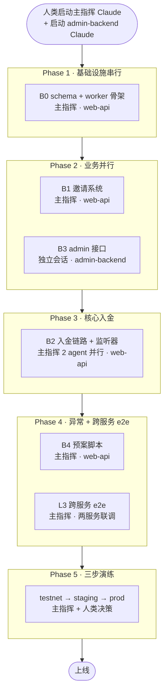

# DD-INVEST · 预售认购页 后端实现方案（记账版 V3）

> 关联 PRD：Lark 文档「预售认购页 — 后端实现方案（记账版）V2 · 2026-05-21」（V3 增量在第三章「Check this」+ 2026-05-25 grill-me 决策清单）
> 关联前端：`oddfi-frontend/app/[locale]/invest/` + `/Users/hang/Downloads/investment-prototype_V4.html`
> DD 维护：`@khan` · V3 重写于 2026-05-25
> V2 → V3 变化说明：见 [00-architecture.md §6](00-architecture.md)

## 1 V2 → V3 决策总览（grill-me 8 支收口）

V3 是对 V2 的**结构性重构**，主要因为 PRD V2 → V3 引入的预案灵活性 + web3 用户心智回归。8 个支线全部 grill 完毕：

| # | 支线 | 决策 |
|---|---|---|
| 1 | 邀请系统 | 站点级 `/api/v1/referral/*`；邀请码 `0x` + 6 位大写易读字符（去 0/O/1/I/L 共 30 字符集），不区分大小写；首次登录自动生成；URL 自动绑 + 失败 Toast + 手动绑 + LocalStorage 保意图；不可撤销不可改 |
| 2 | 入金链路 | **Deposit-first 模型 B**（事件驱动）：无 pending 订单，链上 USDT Transfer 即真相；前端 report-tx + Worker 监听双轨；幂等键 `uk_(tx_hash, log_index)` |
| 3 | 边界处理 | 前端 2min 禁下单 + 后端 5min 边界容差；超时按下一轮算；用户投诉走预案脚本迁移 round_id |
| 4 | 轮次运营 | `paused` 状态机；`manual_override=true` 让 cron 不动；reopen ended 轮次（end_ts 不变靠手动 close）；TGE 改期与 round 时间窗解耦 |
| 5 | Vesting / Claim | **整段砍**：schema 字段保留（释放规则 / claimed 等），本期不实现 cron / 签名 / 热钱包发放 |
| 6 | 价格源 | **整段砍**：预售后端不管 ODD 价格；今日单价 / 今日价值由独立平台币汇率服务提供，前端调用拼数据 |
| 7 | Admin 接口 | 全部搬 `oddfi-admin-backend`（复用 Lark OAuth + JWT + 4 角色 RBAC + 限流）；web-api 的 `/admin/*` 零鉴权问题留 SEC-001 单独治理 |
| 8 | 异常处理 | `presale_ops_event` 表 + Lark Webhook 推送 + Claude Code skill 封装预案脚本，运营 SSH 跑脚本或走 admin HTTP 接口（两条路径都落 `presale_admin_audit`） |

## 2 文档导航

| 文档 | 用途 |
|---|---|
| [00-architecture.md](00-architecture.md) | 总体架构 / 双服务拆分 / 链路图 / V2→V3 决策与风险 |
| [**OVERVIEW.md**](OVERVIEW.md) | 🌟 **第一站** — 实战服务拓扑全景图：5 服务 + 链上 + Lark 交互链路 / 主机端口分布 / 6 大流程 / 鉴权链路 / DB 写权限归属 |
| [01-data-model.md](01-data-model.md) | 9 张表 schema / 状态机 / 不变量 / migration 顺序 |
| [02-api-contract.md](02-api-contract.md) | web-api 用户接口（公开 + JWT） |
| [03-admin-api-contract.md](03-admin-api-contract.md) | admin-backend 运营接口 + RBAC 矩阵 |
| [batches/B0-foundation.md](batches/B0-foundation.md) | schema + repository + worker 骨架 |
| [batches/B1-referral.md](batches/B1-referral.md) | 站点级邀请系统（解耦 + 邀请码生成 + 绑定流程） |
| [batches/B2-deposit.md](batches/B2-deposit.md) | Deposit-first + report-tx + USDT 监听器 + 双轨会师 |
| [batches/B3-admin.md](batches/B3-admin.md) | admin-backend 模块（路由 + RBAC + audit + 状态机操作） |
| [batches/B4-ops-scripts.md](batches/B4-ops-scripts.md) | 预案脚本 + Claude skill 封装 + Lark webhook |
| [testing/adversarial-cases.md](testing/adversarial-cases.md) | 对抗性测试矩阵（金额 / 边界 / 超额 / 并发 / 邀请） |
| [testing/e2e-scenarios.md](testing/e2e-scenarios.md) | 端到端业务流（deposit / 跨轮次 / paused / 多金库） |
| [testing/fuzz-spec.md](testing/fuzz-spec.md) | report-tx 接口 fuzz |
| [testing/regression-plan.md](testing/regression-plan.md) | 全量回归 checklist（testnet → staging → prod 三步） |
| [ops/cutover-dd003.md](ops/cutover-dd003.md) | DD-003 cutover runbook（admin RPC + 双服务部署，2026-05-26 实施完成）|
| [ops/reset-and-vault-switch-runbook.md](ops/reset-and-vault-switch-runbook.md) | 重置 + 测试金库 → 正式金库切换 SOP |
| [ops/monitoring-alerts.md](ops/monitoring-alerts.md) | 监听器游标 / Worker leader / anomaly Lark |

**已删除**（V2 → V3）：
- ~~`batches/B3-position-vesting.md`~~（vesting cron 砍）
- ~~`batches/B4-claim-history.md`~~（claim worker 砍）

## 3 Batch 划分（task-driven）

```
B0 基础设施（1 agent）
   └─ 9 张表 migration + model + repository + presale-worker 骨架
        │
B1 站点级邀请（1 agent）
   └─ /api/v1/referral/* + 邀请码生成 + 绑定 + 列表
        │
B2 入金链路（2 agent 并行 + verifier 会师）
   ├─ A: GET /config + POST /deposit/report-tx + GET /deposit/* + GET /position
   └─ B: USDT 监听器（多金库地址池）+ Round status cron + 双轨会师 + holding upsert
        │
B3 管理后台（2 agent 并行，跨仓库）
   ├─ A: admin-backend 仓库的 /admin/presale/* handler/service/repository
   └─ B: admin-backend audit middleware + RBAC 注册 + docs/presale-admin/README.md
        │
B4 异常处理 + 预案（1 agent）
   └─ presale_ops_event + Lark webhook + ops 脚本 + Claude skill 封装
        │
全量回归 + security-reviewer 终审
   └─ testnet → staging → prod
```

### 工期估算（task-driven，不 time-driven）

| Batch | 量级 | 并行 | 串行 gate |
|---|---|---|---|
| B0 | schema 中等 | 1 agent | code-reviewer + go test ./internal/repository |
| B1 | 中等 | 1 agent | code-reviewer + 对抗（邀请码冲突 / 自邀 / 重复绑定） + 接口模糊 |
| B2 | **重头**：链上集成 | 2 agent + 1 verifier | code-reviewer + 对抗（边界切轮 / 超额 / 多金库 / 双轨竞态 / 链上 reorg） + e2e |
| B3 | 中等：跨仓库 | 2 agent | code-reviewer + RBAC 角色矩阵测试 + audit 中间件单测 |
| B4 | 轻量 | 1 agent | code-reviewer + 预案脚本 dry-run 测试 + Lark webhook 推送测试 |
| 全回归 | 1 verifier | security-reviewer 终审 + 全部 batch 测试集合跑通 |

## 4 串行 gate 不通过则不进下一 batch

每个 batch 结束必须依次通过：

1. **code review**：`oh-my-claudecode:code-reviewer` 按 GUIDE-code-review 走，Critical / High 必须修
2. **对抗测试**：见 [testing/adversarial-cases.md](testing/adversarial-cases.md) 对应章节
3. **接口模糊**：见 [testing/fuzz-spec.md](testing/fuzz-spec.md) 对应章节
4. **e2e 子集**：见 [testing/e2e-scenarios.md](testing/e2e-scenarios.md) 当前 batch 覆盖部分

全部 5 个 batch 完成后跑：
- 全量回归（[testing/regression-plan.md](testing/regression-plan.md)）
- security-reviewer 终审（重点：邀请码碰撞 / 双轨幂等 / from 严格匹配 / vault 多地址池 / 边界容差 / admin RBAC / audit 不可篡改）

## 5 并行 agent 编排建议

每个 batch 推荐使用：

```
/team B<n>  --agents executor:2,verifier:1  --task-file batches/B<n>-*.md
```

- Task Prompt 已在每个 batch 文档底部以「### Task Prompt for agent A / B」准备好
- 跨 batch 必须串行：上一 batch 没过 gate 不能进下一 batch
- 同 batch 内 2 agent 修改文件不重叠（见各 batch 文档「文件边界」一节）
- **跨仓库 batch（B3）**：admin-backend agent 需独立的 worktree（用 `worktree-dev` skill），不能与 web-api worktree 混用

## 6 关键不变量（全程不能破）

1. **金库地址 = 仅收 USDT 的 multisig 冷钱包**，后端永不持有金库私钥
2. **链上 USDT Transfer 即真相**：`presale_deposit` 是事件落库（无 pending 订单中间态）
3. **幂等键 `uk_(tx_hash, log_index)`**：双轨上报（前端 + Worker）保证只入账一次
4. **从地址严格匹配**：`tx.from = 登录态 EOA`，否则进 anomaly（不接受智能合约钱包代付）
5. **邀请奖励一旦入账永不回滚**：运营撤单 / 拉黑走独立"负向调整"流程，不动原 holding
6. **邀请关系 bound_at < block_timestamp 才有效**：绑定时间戳之前的转账无邀请奖励
7. **轮次状态机 `manual_override=1` 后 cron 不再自动推进**：避免运营干预后被 cron 撤销
8. **admin audit 不可篡改**：DB 层只授 INSERT；应用层禁止 DELETE / UPDATE
9. **vault_address 多地址池**：env 改地址后老地址仍要被监听（直到所有老订单确认），靠 `presale_event_cursor` 每地址独立游标
10. **TGE 改期与 round 时间窗解耦**：运营各改各的；vesting anchor 锚定 TGE（本期 schema 保留）

## 7 已对齐项（V3 决策快照 · 2026-05-25）

- ✅ 6 轮初始数据：用前端 `stages.ts`（seed/strategic/ecosystem/public_a/public_b/public_c）
- ✅ TGE 默认 = `2026-06-10 00:00 UTC+8`（运营可改）；TGE 开盘基准价默认 `$0.10`
- ✅ `referral_reward_pct` 默认 10%，运营可逐轮改
- ✅ `min_per_order_usd / max_per_wallet_usd` 字段加 schema，**本期初始 NULL**（无限制）
- ✅ `presale_round.status` 枚举：`upcoming / active / paused / ended`
- ✅ 前端 2min 禁下单 + 后端 5min 边界容差
- ✅ Vault 监听器支持多地址池（env `PRESALE_VAULT_POOL` 数组）
- ✅ `presale_deposit.status` 仅有 `pending / confirmed / anomaly` 三态
- ✅ 邀请系统站点级（路由前缀 `/api/v1/referral/*`、表 `user_referral_*`）
- ✅ Admin 接口在 `oddfi-admin-backend` 仓库实现，**不在 web-api**
- ✅ web-api `/admin/*` 零鉴权问题（SEC-001）本期不治理
- ✅ ODD 价格由独立平台币汇率服务提供，本期不实现
- ✅ vesting / claim / 热钱包整段砍，schema 字段保留待后续合约就绪
- ✅ 运营预案脚本路径：`web-api/scripts/presale-ops/*.go`，封装为 `.claude/skills/presale-ops/`
- ✅ Lark Webhook 接 anomaly + paused 入账信息流
- ✅ presale-worker 与 web-api 同机部署（生产 `oddfi-backend` 单 EIP `<SERVER_IP>`，开发 `oddfi-dev`）
- ✅ 演练流程 task-driven：testnet → staging → prod（无固定时间预算）

---

## 8 实施启动（Implementation Kickoff）

> 本节是「总指挥 Claude」的入口。所有需要操盘项目的 AI 必须从这里开始；人类向新会话 handoff 时直接复制 §8.1 / §8.6 的 prompt。

### 8.1 启动 Prompt（粘贴给总指挥 Claude）

```
你是 OddFi 预售认购页项目（DD-INVEST V3）的总指挥 Claude。

【你的角色】
- 统筹 oddfi-backend/web-api 仓库 + oddfi-admin-backend 仓库的跨仓库实施
- 协调串行 / 并行 batch（B0~B4）
- 每个 batch 结束做 gate check（code-review + 对抗 + e2e 子集）
- 不通过不进下一 batch
- 输出阶段性进度给人类决策

【入口文档】
/Users/hang/work/oddfi-backend/web-api/docs/dd-invest/README.md

读 README 全文后，重点读以下文件再开工：
- 00-architecture.md（架构 + 风险）
- 01-data-model.md（9 张表 schema）
- 02-api-contract.md（用户接口）
- 03-admin-api-contract.md（admin 接口）
- batches/B0~B4-*.md（各 batch 实施细节 + Task Prompt）
- testing/regression-plan.md（三步演练）

【开工次序】见 §8.4。

【你必须遵守】
- 项目规范：oddfi-backend/web-api/CLAUDE.md（注释中文 / 业务逻辑必须有注释 / 单次任务 ≤ 5 文件）
- Git 工作流：所有 batch 必须开 worktree 在 .claude/worktrees/<batch-slug>/，不能直接在 main / dev 上改
- 严禁绕过 hook：--no-verify / SKIP_* 一律违规
- DD/ENH 方案：本 DD 已经 grill 完毕并人工 review，可以直接开工，不需要再次 review

【你能做的】
- web-api 仓库（B0/B1/B2/B4）：直接 implement，用 worktree-dev skill 起 worktree
- 跑测试、code review、verify
- 报告进度、提出技术决策

【你不能做的】
- 跨仓库 cd 切换实施 admin-backend（B3 必须由人类启动独立会话，见 §8.6）
- 跳过 gate check 进下一 batch
- push 到 main / 任何长期分支不经人类同意
- 改生产 env（PRESALE_VAULT_POOL / TGE_TS / 等）
- force push / rm -rf / 删 migration 文件

【你的第一个动作】
读 README + 00 + 01 后向人类报告：
- 我已理解项目范围
- 我准备先开 B0
- 我会开 worktree .claude/worktrees/b0-foundation/，从 dev 分支拉取
- 询问人类是否同意启动

不要在没有人类回应前自动开干。
```

### 8.2 任务开展方案（仓库分布）

| Batch | 实施仓库 | 主导方 | 说明 |
|---|---|---|---|
| B0 基础设施 | oddfi-backend (web-api) | 主指挥 Claude | 9 表 migration + worker 骨架 |
| B1 站点级邀请 | oddfi-backend (web-api) | 主指挥 Claude | `/api/v1/referral/*` |
| B2 入金链路 | oddfi-backend (web-api) | 主指挥 Claude（2 agent 并行） | 双轨上报 + 监听器 |
| **B3 管理后台** | **oddfi-admin-backend** | **独立会话 Claude**（§8.6） | 17 个 admin 接口 |
| B4 预案脚本 | oddfi-backend (web-api) | 主指挥 Claude | scripts + Claude skill + Lark |

**跨仓库工作流**：

```
oddfi-backend/web-api               oddfi-admin-backend
 └─ B0/B1/B2/B4 实施                 └─ B3 实施
      ↓                                    ↓
 共享 MySQL 实例（同一数据库；presale_* 表）
      ↓                                    ↓
 各自 git PR / squash merge 到自己仓库 main
```

**两仓库的桥**：业务表 migration 在 web-api 仓库；admin-backend 启动时**不自动建表**，依赖 web-api migration 先跑。`presale_admin_audit` 表 migration 在 admin-backend 仓库。

### 8.3 多 Agent 协调 + 并行开发方案

| Batch | Agent 数 | 拆分 | 文件边界 |
|---|---|---|---|
| B0 | 1 | 不拆 | 见 batches/B0-foundation.md "文件边界" 节 |
| B1 | 1 | 不拆 | 见 batches/B1-referral.md |
| B2 | **2 并行 + 1 verifier** | A 用户接口 / B 监听器+cron+confirm-deposit | 见 batches/B2-deposit.md "Task Prompt for agent A / B" |
| B3 | **2 并行**（独立会话内） | A handler/service/repository / B router+audit+RBAC+docs | 见 batches/B3-admin.md |
| B4 | 1 | 不拆 | 见 batches/B4-ops-scripts.md |

**Agent 启动命令模板**（主指挥用）：

```bash
# 起 worktree（统一在 .claude/worktrees/，已是项目约定）
cd /Users/hang/work/oddfi-backend
git worktree add web-api/.claude/worktrees/b<n>-<slug> -b feat/dd-invest-b<n> dev

# 主指挥在该 worktree 内 spawn executor agent
# 单 agent：直接 Agent tool 调用
# 双 agent：单次消息内两个 Agent tool 并行调用
```

**并行 batch 内的文件冲突防护**：依赖每个 batch 文档"文件边界"小节列出 agent A / B 各自 touch 的文件清单；agent 实施过程中如发现非本任务的文件变更，按 `.claude/rules/agent-delegation.md` "并行 Agent 文件冲突检测" 流程上报。

### 8.4 开工次序



**串行 / 并行依赖**：

- B0 **必须最先**完成（其他 batch 都依赖 schema）
- B1 + B3 可以**完全并行**（两个不同仓库，schema 已有）
- B2 **依赖 B1**（confirm-deposit 事务里要调用 referral service 反查邀请关系）
- B4 **依赖 B2 + B3**（预案脚本要覆盖 anomaly + audit）
- L3 e2e **依赖全部 batch 完成**

**Gate Check 协议**（每个 batch 完成必须通过）：

1. code-reviewer agent（`oh-my-claudecode:code-reviewer`）跑过 → Critical / High 必须修
2. 对抗矩阵（testing/adversarial-cases.md 对应章节）→ P0 / P1 必须通过
3. 接口 fuzz（testing/fuzz-spec.md）
4. e2e 子集（testing/e2e-scenarios.md 当前 batch 覆盖部分）
5. **主指挥向人类汇报，等人类同意**才进下一 batch

### 8.5 测试驱动方案（3 层 + 三步演练）

**L1 单元测试**（各仓库各自跑）

```
web-api：
  go test ./internal/repository/... ./internal/service/...
  覆盖：BindReferral / ConfirmDeposit / UpsertHolding / Anomaly 检测 / 加权成本价 / CSPRNG

admin-backend：
  go test ./internal/handler/... ./internal/service/...
  覆盖：状态机转换 / RBAC / audit middleware / migrate-round 事务
```

**L2 服务内 integration**（各仓库自己跑，dev 库 + mock RPC）

```
web-api：
  dev MySQL + dev Redis + mock BSC RPC + mock vault address
  跑 deposit 完整流程：report-tx → 双轨会师 → holding upsert → position 查询
  跑 worker：监听器抓 USDT Transfer mock event

admin-backend：
  dev MySQL + Lark OAuth dev-token bypass
  跑 17 个接口的 RBAC 矩阵（4 角色 × 17 接口 = 68 组）
  跑 audit middleware：模拟 mutate 接口 + 验证 audit 表写入
```

**L3 跨服务 e2e**（主指挥在 web-api 仓库实施 + admin-backend 服务同时启动）

```
环境：
  - web-api dev 服务（含 presale-worker）
  - admin-backend dev 服务（独立进程）
  - 共享 dev MySQL
  - BSC testnet RPC + testnet USDT + 测试金库地址

跑全套 testing/e2e-scenarios.md 7 个 E2E：
  E2E-01 正常入账
  E2E-02 边界切轮兜底
  E2E-03 邀请关系完整链
  E2E-04 超额到账预案
  E2E-05 无主转账确认
  E2E-06 金库切换演练
  E2E-07 pause + reopen 全周期

实施方式：
  - 测试代码放在 web-api 仓库 internal/test/e2e/presale_*_test.go
  - 通过 HTTP 调用 admin-backend 接口（不直连 admin-backend DB）
  - 跨服务调用走 LARK 配置好的 dev URL
```

**三步演练**（testing/regression-plan.md 详述）

```
Step 1 testnet
  环境：dev-api.oddfi.io + admin.oddfi.io（dev 模式）+ BSC testnet
  范围：L1 + L2 + L3 全跑
  主导：主指挥 Claude
  通过：testing/regression-plan.md §Step 1 checklist 全 ✅

Step 2 staging  
  环境：mainnet RPC + 临时金库地址（隔离正式资金）+ 内部钱包小额真 USDT
  范围：核心 E2E + 多金库切换演练
  主导：人类决策切流节奏，主指挥协助
  通过：连续 24h 无 P0 / P1 事件

Step 3 prod
  环境：正式金库 + 前端灰度白名单 EOA
  范围：监控为主，业务流以人类操作为准
  主导：人类
  灰度顺序：内部 10 人 → 100 人 → 1000 人 → 全开
```

### 8.6 admin-backend 仓库 handoff prompt（粘贴给独立会话 Claude）

人类：cd 到 `/Users/hang/work/oddfi-admin-backend` 启动新 Claude 会话后，把下面整段粘贴过去：

```
你将在 oddfi-admin-backend 仓库实施 OddFi 预售运营后台（DD-INVEST V3 的 B3 batch）。

【任务范围】
DD 完整文档（必读，按顺序）：
1. /Users/hang/work/oddfi-backend/web-api/docs/dd-invest/README.md（特别看 §8 实施启动）
2. /Users/hang/work/oddfi-backend/web-api/docs/dd-invest/00-architecture.md §2 / §8.2（双服务架构 + admin-backend 集成点）
3. /Users/hang/work/oddfi-backend/web-api/docs/dd-invest/01-data-model.md §3.9（presale_admin_audit）+ §3.1 §3.2 §3.3（你要操作的业务表）
4. /Users/hang/work/oddfi-backend/web-api/docs/dd-invest/03-admin-api-contract.md（17 个接口契约 + RBAC 矩阵 + 错误码）
5. /Users/hang/work/oddfi-backend/web-api/docs/dd-invest/batches/B3-admin.md（实施细节 + 文件边界 + Task Prompt for agent A / B）

本仓库实施入口（已经备好）：
6. /Users/hang/work/oddfi-admin-backend/docs/presale-admin/README.md（curl 示例 + 实施指南 + RBAC 模式）

本仓库项目规则：
7. /Users/hang/work/oddfi-admin-backend/CLAUDE.md
8. /Users/hang/work/oddfi-admin-backend/.claude/rules/rbac.md（现有 4 角色 + 路由权限矩阵；你要补预售路径）
9. /Users/hang/work/oddfi-admin-backend/ARCHITECTURE.md

【你的工作】
1. 起 worktree：git worktree add .claude/worktrees/presale-admin -b feat/presale-admin
2. cd .claude/worktrees/presale-admin
3. 按 B3-admin.md 的 "Task Prompt for agent A / B" 并行起 2 个 executor agent：
   - Agent A：handler/service/repository（17 个接口业务逻辑）
   - Agent B：router/audit middleware/RBAC 注册/docs/presale-admin/README.md 补 curl 示例
4. 文件边界严格隔离（见 B3-admin.md "文件边界" 节）
5. 跑 gate check：单元测试 + RBAC 矩阵测试 + audit 中间件单测
6. 完成后向人类汇报 + 准备 PR

【你必须遵守】
- admin-backend 项目规则（CLAUDE.md）
- 不能跑 --no-verify
- 不能直接 push origin main
- 不能改 migrations/0001_create_admin_users.sql（已落地）
- 你的 audit 表 migration：0002_create_presale_admin_audit.sql
- 你不需要操作 web-api 仓库的代码（业务表 schema 由 web-api 主指挥的 B0 提供）

【你能假设的前提】
- web-api 仓库的主指挥 Claude 已经完成 B0（业务表 migration 已跑过 dev MySQL）
- 共享 MySQL 实例，你的 admin-backend 直接 GORM 操作 presale_* 表
- web-api 主指挥可能正在并行做 B1（站点级邀请），不会触碰你的代码

【你的第一个动作】
读完文档后向人类报告：
- 我已理解 B3 任务范围
- 我准备起 worktree feat/presale-admin
- 我会先实施 audit middleware（B 路），再启 agent A 实施业务接口
- 询问人类是否同意启动

不要在没有人类回应前自动开干。
```

### 8.7 主指挥 Claude 与 admin-backend Claude 的协同点

| 节点 | 谁通知谁 | 内容 |
|---|---|---|
| B0 完成 | 主指挥 → 人类 → admin-backend Claude | "业务表 migration 已跑过，你可以开始 B3 了" |
| B3 完成 | admin-backend Claude → 人类 → 主指挥 | "admin 17 接口 ready，可以开 L3 e2e" |
| L3 e2e 需要联调 | 主指挥 → 人类 → 双 Claude | 同步启动 dev 服务 + 跑 e2e 矩阵 |
| staging 切换 | 主指挥 → 人类 | 人类决策何时切 |
| prod 灰度 | 主指挥 → 人类 | 人类操作灰度开关 |

**两个 Claude 不直接通信**（无 IPC / shared file），所有同步通过**人类**做信使。这是设计上的安全边界：避免一个 Claude 误操作另一个仓库。

