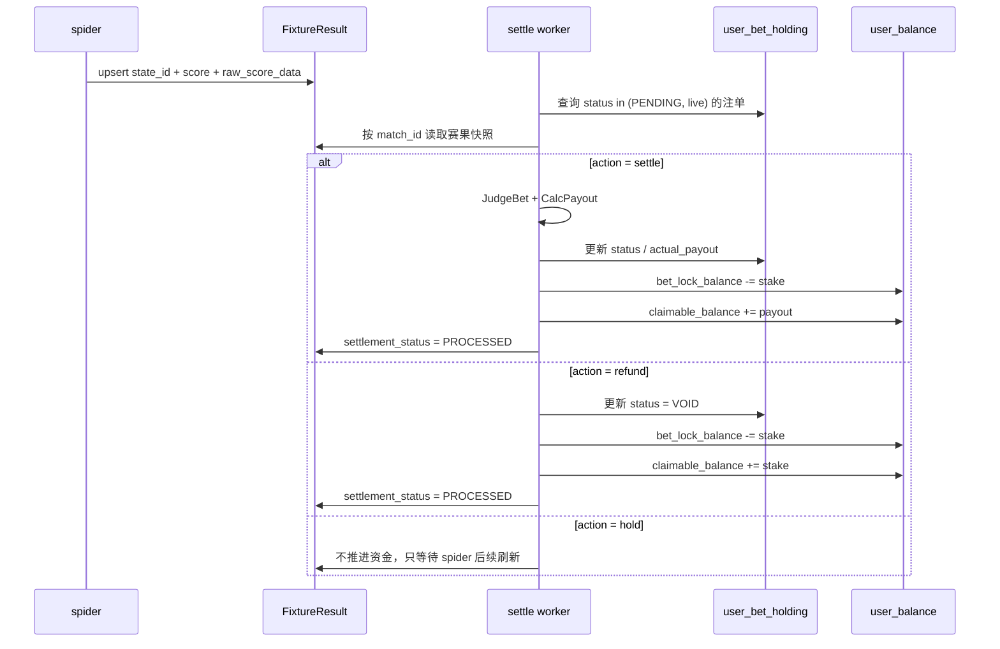

# oddfi-bet-settle 仓库架构图

本文档描述当前仓库在正式方案下的职责边界。核心原则只有一句：

`spider 管采集事实，bet-settle 管结算资金。`

## 1. 总体架构

```mermaid
flowchart LR
    A[SportMonks /fixtures/{id}] --> B[spider 服务]
    B --> C[FixtureDB<br/>赛事主档]
    B --> D[FixtureResult<br/>状态/比分快照]
    B --> E[OddDB<br/>赔率快照]
    B --> F[StatisticsDB<br/>统计快照]

    D --> G[bet-settle worker]

    G --> I[user_bet_holding]
    G --> J[user_balance]
    G --> D
```

## 2. 服务职责

### spider 服务

- 定时请求 SportMonks `fixtures/{id}`
- 拍平并写入 `FixtureDB`
- 写入 `FixtureResult`
- 写入 `OddDB`
- 写入 `StatisticsDB`

### bet-settle worker

- 只读取数据库，不再直接请求 SportMonks
- 从 `user_bet_holding` 找出未结注单
- 关联 `FixtureResult.state_id`
- `state_id -> result/action`
- `action=settle` 时按比分结算
- `action=refund` 时整单 `VOID`
- 单事务更新：
  - `user_bet_holding.status`
  - `user_bet_holding.actual_payout`
  - `user_balance.bet_lock_balance`
  - `user_balance.claimable_balance`
  - `fixture_results.settlement_status`

### web-api 服务

- 对外 HTTP API 统一收敛到 web-api 服务
- bet-settle 不再暴露端口，也不提供 `GET /v1/match/:id/state`
- web-api 如需比赛状态，可直接读取 spider 落库的 `FixtureDB / FixtureResult`

## 3. 关键数据流



## 4. 表职责

### `FixtureDB`

用途：赛事主档。

建议承载：

- `id`
- `league_id`
- `season_id`
- `stage_id`
- `name`
- `starting_at`
- `state_id`
- 主客队拍平字段
- `has_odds`
- `created_at`
- `updated_at`

不建议承载：

- 全量比分明细
- 点球/加时细节
- 结算状态机字段

### `FixtureResult`

用途：赛果快照 + 结算状态机。

建议承载：

- `fixture_id`
- `state_id`
- `state_code`
- `state_name`
- `home_score_full`
- `away_score_full`
- `home_score_half`
- `away_score_half`
- `home_score_extra`
- `away_score_extra`
- `home_score_penalty`
- `away_score_penalty`
- `raw_score_data`
- `raw_state_data`
- `settlement_status`
- `remark`
- `updated_at`

### `user_bet_holding`

用途：用户注单事实。

结算服务只更新：

- `status`
- `actual_payout`
- `updated_at`

### `user_balance`

用途：用户资金承接账户。

结算服务只更新：

- `bet_lock_balance`
- `claimable_balance`

## 5. 当前仓库代码入口

- [cmd/server/main.go](/Users/rongweihe/Desktop/Oddfi-Code/oddfi-bet-settle/cmd/server/main.go:1)
- [cmd/worker/worker.go](/Users/rongweihe/Desktop/Oddfi-Code/oddfi-bet-settle/cmd/worker/worker.go:1)
- [internal/service/settle_service.go](/Users/rongweihe/Desktop/Oddfi-Code/oddfi-bet-settle/internal/service/settle_service.go:1)
- [internal/model/model.go](/Users/rongweihe/Desktop/Oddfi-Code/oddfi-bet-settle/internal/model/model.go:1)
- [internal/model/match_state.go](/Users/rongweihe/Desktop/Oddfi-Code/oddfi-bet-settle/internal/model/match_state.go:1)

## 6. 现在的关键边界

- `MatchDB` 仅保留兼容定义，不再作为主流程依赖
- worker 不再请求 SportMonks
- 对外比赛状态查询已从本服务移除，统一由 web-api 服务承接
- 正式环境里，`FixtureDB` 和 `FixtureResult` 必须由 spider 持续更新，否则结算不会推进

## 7.持仓表数据模型最新
```go
// 用户 持仓 记录表
type UserBetHolding struct {
	ID          uint64 `gorm:"primaryKey;autoIncrement" json:"id"`                                                              // 物理主键：订单号
	UserID      uint64 `gorm:"index:idx_user_status;uniqueIndex:idx_user_client_ref_odd" json:"user_id"`                        // 逻辑关联：用户ID
	OddID       int64  `gorm:"index;uniqueIndex:idx_user_client_ref_odd" json:"odd_id"`                                         // 投注的 marketId
	ClientRefID string `gorm:"column:client_ref_id;size:64;uniqueIndex:idx_user_client_ref_odd" json:"client_ref_id,omitempty"` // 客户端幂等键，防止重试重复下注

	// 【新增】玩法与盘口特征（对应文档 judgeBet 依赖）
	Market       string          `gorm:"type:varchar(20)" json:"market"`         // 玩法：fulltime_result, asian_handicap, asian_over_under
	Label        string          `gorm:"type:varchar(20)" json:"label"`          // 投注项：1(主), 2(客), over(大), under(小)
	HandicapLine decimal.Decimal `gorm:"type:decimal(8,2)" json:"handicap_line"` // 盘口线：例如 -0.5, 2.5 (大小球线也复用此字段)

	// 【改造】拆分预计与实际派彩
	EstimatedPayout decimal.Decimal `gorm:"type:decimal(16,2)" json:"estimated_payout"` // 预计赔付 (Stake * Odds)
	ActualPayout    decimal.Decimal `gorm:"type:decimal(16,2)" json:"actual_payout"`    // 【新增】实际派彩 (WON满赔, PUSH退本金/扣手续费, LOST为0)

	Stake     decimal.Decimal `gorm:"type:decimal(16,2)" json:"stake"`      // 下注金额
	Odds      decimal.Decimal `gorm:"type:decimal(8,4)" json:"odds"`        // 下注时的赔率快照
	Payout    decimal.Decimal `gorm:"type:decimal(16,2)" json:"payout"`     // 预计赔付 (Stake * Odds)
	Status    string          `gorm:"index:idx_user_status;default:'live'"` // live, WON, LOST
	Type      string          `gorm:"type:varchar(20)"`                     // SINGLE, PARLAY
	CreatedAt time.Time       `json:"created_at"`
	UpdatedAt time.Time       `json:"updated_at"` // 【新增】记录结算更新时间
}
```
